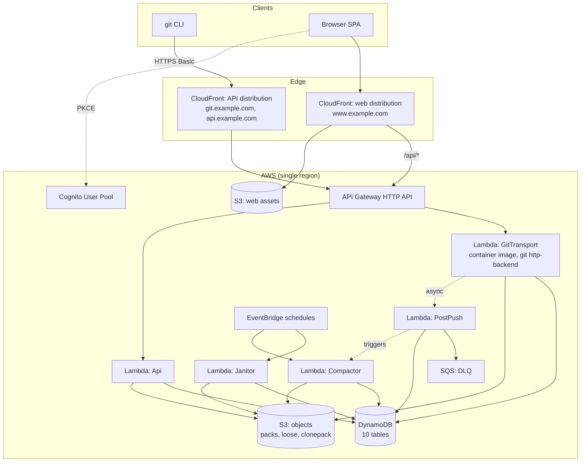
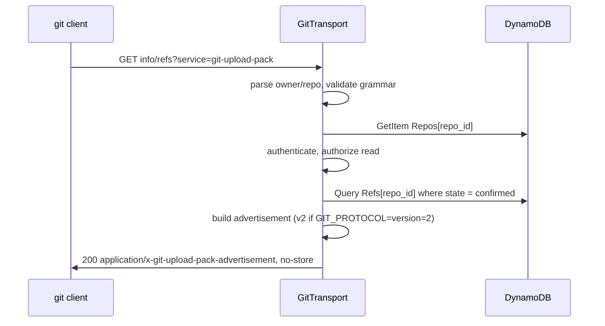
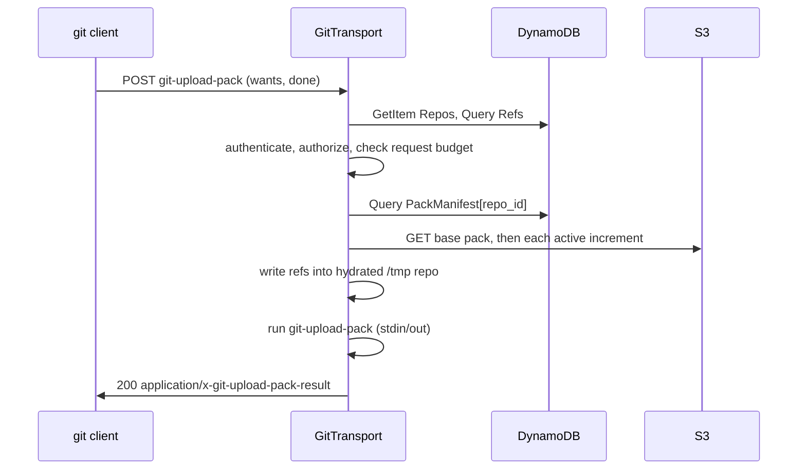
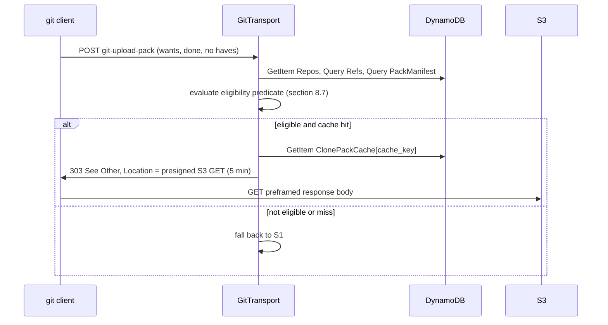
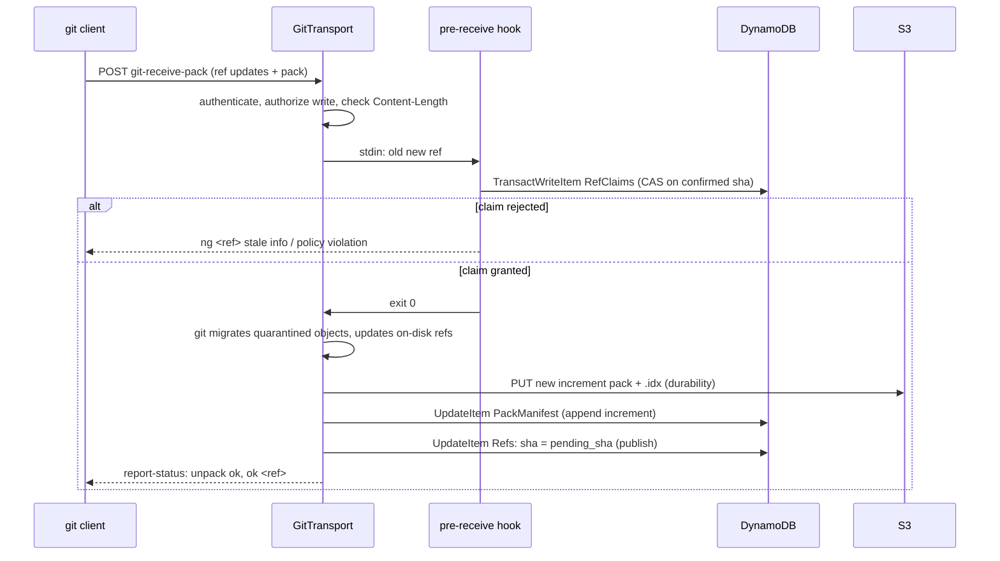

# DESIGN.md — AWSGit: a serverless GitHub clone on AWS Lambda and S3

Implementation-ready specification for a GitHub-like git hosting service whose entire
compute path is AWS Lambda and whose git object store is Amazon S3.

- **Status:** draft for implementation
- **Version:** 1.0.0
- **Audience:** implementers of this repository
- **Precedence:** `AGENTS.md` (process) > `docs/adr/*` (decided trade-offs) > this file
  (architecture) > `README.md`
- **Companion documents:** `AGENTS.md`, `docs/adr/`, `README.md`

---

## 0. Document control

### 0.1 Change log

| Version | Change | Notes |
|---|---|---|
| 1.0.0 | Initial specification | Nothing implemented yet; toolchain not bootstrapped |

### 0.2 Glossary

| Term | Meaning |
|---|---|
| **PAT** | Personal access token — the credential a git client presents over HTTP Basic |
| **pkt-line** | The git wire framing: a 4-hex-digit length prefix followed by that many bytes including the prefix |
| **Advertisement** | The `info/refs` response listing refs and server capabilities |
| **Base pack** | The single repacked `.pack` holding the bulk of a repository's history |
| **Increment pack** | A `.pack` appended by one push, never rewritten |
| **Manifest** | The DynamoDB record of which packs currently constitute a repository |
| **Hydration** | Materialising a bare repository in the Lambda's `/tmp` from S3 packs and DynamoDB refs |
| **Confirmed ref** | A ref whose new objects are durable in S3 and which is therefore published to clients |
| **Pending claim** | A ref update reserved by a push but not yet confirmed |
| **S1/S2/S3/S4** | The four git data-plane strategies defined in section 8.7 |
| **T1/T2** | The two git transports defined in section 8.1 |
| **OAC** | CloudFront Origin Access Control |

### 0.3 Repository layout

This layout is mandated by `AGENTS.md` section 2 and is used throughout this document.

```text
AGENTS.md
DESIGN.md
README.md
infra/                      AWS SAM templates and samconfig.toml
src/
  git-transport/            smart-HTTP git protocol, CGI adapter, hydration, hooks
  api/                      REST API handlers
  jobs/                     asynchronous and scheduled work
  shared/                   pure, dependency-light code with no AWS imports
web/                        browser SPA
tests/
  unit/ integration/ e2e/ fixtures/
docs/adr/                   Architecture Decision Records
```

---

## 1. Overview

### 1.1 What this is

AWSGit is a multi-tenant git host with no servers. It speaks the real git smart-HTTP
protocol, so an unmodified `git` client can clone, fetch, and push against it. Git objects
live in S3; references, repository metadata, users, and tokens live in DynamoDB; every
request is served by a Lambda. It is provisioned with AWS SAM and written in TypeScript.

### 1.2 Goals

| ID | Goal |
|---|---|
| G1 | An unmodified `git` client can clone, fetch, and push without a custom remote helper |
| G2 | All compute is Lambda; no EC2, ECS, or Fargate in the request path |
| G3 | Git object storage is S3, and objects are immutable once written |
| G4 | Push correctness is never dependent on a single execution environment surviving |
| G5 | Private repositories are genuinely private, and one tenant can never read another's objects |
| G6 | A browser can browse files, commits, and diffs for any repository the user may read |
| G7 | Cost scales with use, is measurable per operation, and has no idle floor beyond storage |

### 1.3 Non-goals

Explicitly out of scope for v1. Each is a deliberate omission, not an oversight.

| Not building | Why |
|---|---|
| Issues, pull requests, reviews | Collaboration features are a separate product surface with their own schema; adding them would double the design without exercising the git path |
| CI/CD, Actions, runners | Requires code execution on untrusted input — a security problem deserving its own design |
| Code search across history | Needs an inverted index; S3 and DynamoDB alone cannot serve it |
| Fork networks and shared object pools | Adds cross-repository read authorization and reference counting |
| SHA-256 repositories | `object-format=sha256` changes every hash, key, and validation rule; SHA-1 only in v1 |
| Git LFS | Needs a batch API, pointer rewriting, and a separate object lifecycle |
| Multi-region active-active | Requires cross-region ref coordination; v1 is single-region |
| OAuth apps, GitHub App installations, webhooks to third parties | Outbound delivery, retries, and signing |
| A custom git remote helper for oversized pushes | Documented as the escape hatch in section 8.7; not required for v1 |

### 1.4 Design principles

1. **Objects are immutable and content-addressed.** Nothing in S3 is ever overwritten. A key
   can be written once or not at all, which removes an entire class of concurrency bug.
2. **Refs are the only mutable state, and they are transactional.** Every ref change is a
   conditional write; a push that loses a race sees a clean rejection, never a lost update.
3. **Durability precedes publication.** A ref is published only after its objects are in S3.
   A client that can see a ref can always fetch what it points at.
4. **Reuse git itself.** Protocol framing, pack indexing, delta resolution, and negotiation
   are handled by the real `git` binary, not reimplemented. Reimplementing pack parsing is
   how servers silently corrupt data.
5. **Fail before spending.** Authorization and metadata checks happen before any object data
   is fetched, so a rejected request costs almost nothing.
6. **Keep large bytes out of Lambda.** Data belongs in S3 and in the client's socket; a
   handler should orchestrate, not relay.

---

## 2. Requirements

### 2.1 Functional requirements

| ID | Requirement |
|---|---|
| F-1 | Create, read, update, and delete repositories through the REST API |
| F-2 | `git clone`, `git fetch`, and `git pull` over HTTPS for public and private repositories |
| F-3 | `git push` for new branches, fast-forward updates, tag pushes, branch deletion, and (when permitted) force pushes |
| F-4 | Authenticate git clients with personal access tokens over HTTP Basic |
| F-5 | Authenticate browser sessions with Cognito and an OAuth 2.0 authorization-code + PKCE flow |
| F-6 | Enforce per-repository roles: read, write, admin |
| F-7 | Support public repositories readable without authentication, when the owner enables it |
| F-8 | Return `401` with a `WWW-Authenticate` challenge so that `git` prompts for credentials |
| F-9 | List branches, tags, commits, and trees through the REST API |
| F-10 | Read file contents at any ref, with binary detection |
| F-11 | Diff two commits or refs and return a unified diff plus structured file entries |
| F-12 | Store git objects durably in S3 and reconstruct a repository for any request |
| F-13 | Compact history so that a clone does not require assembling an unbounded number of packs |
| F-14 | Record an audit event for every ref update, repository change, and token change |
| F-15 | Support protocol v2 completely, and protocol v0 as a fallback |
| F-16 | Serve the browser UI: file tree, file view, commit list, commit detail, diff, branches |
| F-17 | Manage PATs: create, list, revoke, and expire, showing the secret exactly once |
| F-18 | Enforce a maximum push size and a maximum clone size with a clear client-visible error |
| F-19 | Rate-limit authentication attempts and mutating REST operations |
| F-20 | Reclaim orphaned objects and superseded packs without data loss |

### 2.2 Non-functional requirements

| ID | Requirement | Target |
|---|---|---|
| N-1 | `info/refs` latency, warm, p50 | ≤ 300 ms |
| N-2 | `info/refs` latency, warm, p95 | ≤ 900 ms |
| N-3 | Push latency for a 1 MiB pack, warm, p95 | ≤ 3 s |
| N-4 | Clone throughput for a 50 MiB pack | ≥ 1.5 MiB/s end to end |
| N-5 | Maximum repository size | 10 GiB of packed objects |
| N-6 | Maximum single push | 4 MiB by default, configurable per repository up to the transport ceiling |
| N-7 | Availability of the git transport, monthly | 99.9 % |
| N-8 | Durability of committed objects | 99.999999999 % (S3 Standard) |
| N-9 | RPO for committed refs | 0 — a confirmed ref is never lost |
| N-10 | RTO after a regional S3 degradation | Degraded service; reads of cached packs continue |
| N-11 | Cold start for the git transport | ≤ 3 s at p95 with the container image warmed |
| N-12 | Tenant isolation | Zero cross-tenant object readable without an explicit grant |
| N-13 | Cost per 1,000 clones of a 50 MiB repository | ≤ USD 6 at list price |
| N-14 | Cost per 1,000 pushes of a 2 MiB pack | ≤ USD 0.50 at list price |

### 2.3 Assumptions this design depends on

- A single AWS Region, chosen at deploy time and assumed to be `us-east-1` for all cost
  arithmetic in section 17.
- Repositories are SHA-1 and bounded to 10 GiB packed.
- A registered domain and an ACM certificate are available (section 12.6).
- AWS list prices as of the drafting date; section 17 states that they must be re-verified.

---

## 3. Platform constraints

These are not preferences. They are hard limits that shaped every decision below, and every
one of them is cited in Appendix F.

### 3.1 Hard limits

| Limit | Value | Consequence for this design |
|---|---|---|
| Lambda synchronous invocation payload, request | 6 MiB | A push body is capped; oversized pushes need the escape hatch in 8.7 |
| Lambda synchronous invocation payload, response | 6 MiB | A pack served directly through a handler is capped at ~4.5 MiB raw, because API Gateway base64-encodes it (6 MiB ÷ 4 × 3) |
| Lambda streamed response | 200 MiB | With the Function URL transport, clone responses can be far larger than 6 MiB |
| Lambda streamed response bandwidth | Uncapped for the first 6 MiB, then ~2 MiB/s | A 50 MiB streamed clone spends ~22 s in the throttled tail — this is why the redirect strategy in 8.7 exists |
| Lambda function timeout | 900 s | The git transport can outlive the API Gateway budget |
| Lambda `/tmp` | 512 MiB … 10,240 MiB | Hydration needs the large end for a 10 GiB repository |
| Lambda container image | 10 GiB | Room for a full `git` install |
| API Gateway HTTP API payload | 10 MiB | The Lambda 6 MiB cap binds first |
| API Gateway HTTP API integration timeout | 30 s, **not increasable** | Any T1 request must finish in 30 s including hydration |
| API Gateway HTTP API timeout for a Lambda authorizer response | 10 s | Not used — see 7.1 |
| API Gateway request line + headers | 10,240 bytes | Normal git requests fit; a pathological `have` set does not |
| DynamoDB transaction size | 100 items | An `atomic` push of more than 100 refs cannot be a single transaction |
| `packfile-uris` | Protocol v2 only, and the client must opt in via `fetch.uriprotocols` (empty by default) | Cannot be the default path; see 8.7 S4 |
| `http.followRedirects` | Defaults to `initial` | A POST redirect is not followed unless the client sets `true`; see 8.7 S2 |
| CloudFront origin responses | Buffered, not streamed | CloudFront cannot front the streaming transport (T2) |

### 3.2 The two derived budgets

Everything about sizing follows from these two numbers.

**Request budget.** The incoming body is base64-encoded by API Gateway in the Lambda event,
so a 6 MiB Lambda request payload carries at most 4,718,592 bytes of raw body
(6,291,456 ÷ 4 × 3). Reserving 512 KiB of headroom for protocol framing and progress output:

```text
MAX_PUSH_BYTES (T1 default) = 4 MiB = 4,194,304 bytes
```

**Response budget.** The same inflation applies to a response the Lambda returns with
`isBase64Encoded: true`. Reserving headroom:

```text
MAX_CLONE_BYTES (T1, S1 direct) = 4 MiB = 4,194,304 bytes
```

With T2 those ceilings become 6 MiB (request, no base64) and 200 MiB (streamed response).

### 3.3 Git client compatibility

The default configuration works with a stock client for repositories under the budgets
above. Beyond them, a client setting is required. This table is the contract.

| Setting | Default | Required for | Notes |
|---|---|---|---|
| `http.followRedirects` | `initial` | S2 preframed-clone redirects | Must be `true`; without it the client will not re-issue the POST |
| `fetch.uriprotocols` | empty | S4 `packfile-uris` | Must include `https` |
| `http.version` | `HTTP/1.1` | nothing | Both are accepted |
| `http.postBuffer` | 1 MiB | chunked-request workaround | See spike S-2 in section 19 |
| `GIT_PROTOCOL: version=2` | sent by git ≥ 2.26 on request | protocol v2 | Server also serves v0 |
| `credential.helper` | platform default | interactive auth | Server sends `WWW-Authenticate: Basic` |
| `sslVerify` | `true` | nothing | There is no supported reason to disable it |

Minimum supported client: **git 2.30**. The CI matrix covers 2.30, 2.39, 2.50, and latest.

---

## 4. Architecture

### 4.1 Components



### 4.2 Why the extensionless REST client is not behind an API Gateway authorizer

`GET /repos/{owner}/{repo}` must be reachable anonymously for a public repository, but
reachable with a token for a private one. An API Gateway HTTP API JWT authorizer rejects a
request with no token before the Lambda runs, and HTTP API has no "optional authorizer"
mode.

Therefore **no API Gateway authorizer is configured**. Every request — git or REST — passes
through one in-Lambda authentication module in `src/shared/auth/`, which accepts either
HTTP Basic (a PAT) or `Authorization: Bearer` (a Cognito JWT) and resolves a principal. The
authorization decision is then made per route and per repository. This keeps one auth code
path, allows anonymous reads, and avoids a duplicated public/private route table. The cost
is that JWT signature verification and JWKS caching are our responsibility; section 7.4
specifies them, including the algorithm allow-list.

### 4.3 Request flows

#### 4.3.1 Discovery — `GET /{owner}/{repo}.git/info/refs?service=git-upload-pack`



Discovery touches **no S3 objects and writes nothing**. It is the cheapest and hottest
endpoint, which is why it must not hydrate.

#### 4.3.2 Clone — the direct path (S1)



#### 4.3.3 Clone — the preframed path (S2)



#### 4.3.4 Push — the commit protocol

This is the correctness-critical flow. The ordering is not optional.



The numbered contract, which the implementation must follow exactly:

1. `pre-receive` reads `<old-sha> <new-sha> <ref-name>` lines for every ref in the push.
2. It validates, in this order: ref-name grammar; authorization (role, branch protection,
   token scope); fast-forward policy; object-size cap; workspace quota. A failure exits
   non-zero with a message on stderr, which git relays to the client over sideband channel 2.
3. It claims every ref with a `TransactWriteItem` into **`RefClaims`**, conditioned on the
   confirmed `Refs.sha` still equalling `<old-sha>`. This is the only place two concurrent
   pushes are serialised. All-or-nothing, so an `atomic` push either claims every ref or none.
4. On success, `git` migrates objects out of quarantine and updates the on-disk refs.
5. `post-receive` performs, in order: upload new packs and loose objects to S3; append to
   `PackManifest`; then publish each ref by setting `Refs.sha = pending_sha` and deleting the
   claim. Finally it invokes `PostPushLambda` asynchronously.
6. `report-status` is emitted by `git` **after** `post-receive` returns, so the client's
   `ok <ref>` genuinely means the objects are durable.

Failure semantics, which must be preserved:

| Failure point | Objects on S3 | Ref state | Client sees |
|---|---|---|---|
| Rejected in step 3 | none written | unchanged | `ng <ref> <reason>` |
| Crash between 3 and 5 | partial, unreferenced | claim expires; reconciler deletes it | connection error; retry is safe |
| Failure during step 5 upload | partial, unreferenced | claim expires; reconciler deletes it | `ng`; retry is safe |
| Failure publishing in step 5 | durable, unreferenced | claim expires; reconciler deletes it | `ng`; retry is safe |
| `PostPushLambda` fails | durable | **published** | `ok <ref>` — correct |

The invariant: **a claim that is never published leaves no trace beyond unreferenced
objects, and unreferenced objects are collected by the Janitor.** No path exists where a
published ref points at objects that are not in S3.

#### 4.3.5 Browser file browse

```text
GET /api/v3/repos/{owner}/{repo}/contents/{path}?ref=<ref>
  -> ApiLambda: authenticate, authorize read
  -> GetItem Repos, Query Refs (resolve ref to sha)
  -> Query PackManifest, hydrate packs into /tmp (memoised for the execution environment)
  -> git cat-file, git rev-parse (resolve path to tree/blob entries)
  -> 200 { entries } or { content, encoding }
```

### 4.4 Trust boundaries

| Boundary | Crossing data | Control |
|---|---|---|
| Internet → CloudFront | Request headers, bodies, credentials | TLS, WAF (API distribution), rate limiting |
| CloudFront → API Gateway | Same, plus `Authorization` and `Git-Protocol` forwarded | Cache policy `no-store`, header allow-list |
| API Gateway → Lambda | Whole request, base64-encoded | IAM execution role, payload limits |
| Lambda → S3 | Pack and loose object bytes | Least-privilege IAM, KMS, TLS-only bucket policy |
| Lambda → DynamoDB | Metadata and refs | Least-privilege IAM, KMS, conditional writes |
| Lambda → client | Pack data, refs | Authorization already enforced; no store |
| Repository content → browser | Rendered diffs, blob text | Treated as untrusted; escaped; CSP; no inline execution |
| Repository content → `git` child process | Ref names, paths | Argument arrays only, `git check-ref-format`, never a shell |

---

## 5. Storage model

### 5.1 Buckets

Four buckets per environment. Names carry the account and region to stay globally unique.

| Purpose | Name pattern | Versioning | Lifecycle | Public access |
|---|---|---|---|---|
| Git objects | `awsgit-objects-{acct}-{region}` | Off — keys are immutable and content-addressed | `clonepack/` expires after 30 days; `s3-object-lock` not used | Blocked |
| Quarantine | `awsgit-quarantine-{acct}-{region}` | Off | Objects expire after 90 days | Blocked |
| Web assets | `awsgit-web-{acct}-{region}` | Off | Non-current versions expire after 30 days | Blocked; read only through OAC |
| Access logs | `awsgit-logs-{acct}-{region}` | Off | Transition to Glacier Instant Retrieval after 90 days; expire after 400 days | Blocked |

Every bucket: SSE-KMS with the environment CMK, TLS-only via a deny policy on
`aws:SecureTransport=false`, server access logging on the first three, and S3 Block Public
Access fully enabled.

Versioning is deliberately off for the objects bucket. Objects are never overwritten, so
versioning would only pay to store duplicates of data whose key already encodes its content
hash. Any accidental overwrite is a bug that versioning would mask.

### 5.2 S3 key grammar

Canonical repository identity in key space is **lowercased** `{owner}/{repo}`. Display casing
lives in DynamoDB. Lookups normalise before touching a key, which makes repository identity
case-insensitive exactly as it is on GitHub.

```text
repos/{owner_lower}/{repo_lower}/packs/base/{pack_sha}.pack
repos/{owner_lower}/{repo_lower}/packs/base/{pack_sha}.idx
repos/{owner_lower}/{repo_lower}/packs/base/{pack_sha}.bitmap
repos/{owner_lower}/{repo_lower}/packs/inc/{pack_sha}.pack
repos/{owner_lower}/{repo_lower}/packs/inc/{pack_sha}.idx
repos/{owner_lower}/{repo_lower}/loose/{first2}/{rest38}
repos/{owner_lower}/{repo_lower}/clonepack/{cache_key}.bin
repos/{owner_lower}/{repo_lower}/clonepack/{cache_key}.meta.json
```

`pack_sha` is the pack's own trailing SHA-1 as git names it (`pack-<40 hex>` → `<40 hex>`).
`cache_key` is defined in 8.7. `first2` is the first two hex characters of the 40-character
loose object SHA; `rest38` is the remainder. Both are validated against the regexes in
Appendix B before use, so no user-controlled string is ever concatenated into a key.

### 5.3 The pack model

A repository's objects are held as exactly one **base pack** plus zero or more **increment
packs**.

- The base pack is produced by `git repack -ad --write-bitmap-index` and is immutable.
- Each push appends one increment pack containing only the objects that push introduced.
- The `.bitmap` file accompanies the base pack to accelerate `upload-pack` negotiation.
- Increments are never rewritten. Superseding them happens by promoting a new base.

`PackManifest` records which packs are active. A read hydrates the base plus the active
increments; a clone needs all of them, an incremental fetch usually needs only the recent
ones.

This is a log-structured object store with periodic compaction. It gives three properties
that a "one big pack per push" design lacks: pushes never rewrite an existing key (so no
lost-update window on S3), an increment can be uploaded by a Lambda that has no idea what the
base contains, and a failed compaction is a no-op rather than a corruption.

### 5.4 Compaction

Triggered by whichever comes first:

- active increments ≥ 20, or
- active increment bytes ≥ 25 % of base pack bytes, or
- the daily EventBridge sweep finds a repository not compacted in 7 days with ≥ 2 increments.

Algorithm:

1. Acquire a compaction lease: `UpdateItem Repos` setting `compaction_lease_until`, conditioned
   on it being absent or in the past. Two compactors cannot run concurrently for one repository.
2. Hydrate the repository read-only into `/tmp`.
3. Run `git repack -ad --write-bitmap-index -f` to produce one new pack.
4. Upload the new pack, index, and bitmap under `packs/base/{new_sha}.*`.
5. `TransactWriteItem`: insert the new `PackManifest` base row as `active`; mark the previous
   base and all active increments `superseded` with `gc_after = now + 7 days`.
6. Release the lease. On any failure before step 5, the lease expires and nothing changed.

Old packs survive for 7 days so that an in-flight clone that already read the manifest is not
broken mid-transfer. The Janitor deletes them after `gc_after`.

### 5.5 Hydration

Hydration materialises an ephemeral bare repository:

```text
/tmp/git/{owner_lower}/{repo_lower}.git/
  HEAD                      -> symbolic ref to the default branch
  config                    -> bare = true, receive.unpackLimit = 1, http.receivepack = true
  objects/pack/*.pack|.idx  -> downloaded from S3
  objects/{xx}/{rest}       -> downloaded loose objects, if any
  refs/heads/*, refs/tags/* -> written from confirmed DynamoDB refs
  hooks/pre-receive, post-receive
```

Rules:

- Only **confirmed** refs are written. A pending claim is invisible to readers.
- `receive.unpackLimit = 1` keeps any pack of two or more objects as a pack, so a push does
  not scatter thousands of loose objects into S3. A single-object pack becomes one loose
  object, which is uploaded to the `loose/` prefix and folded into the next compaction.
- `receive.denyNonFastForwards = false`; fast-forward policy is enforced per repository in
  the `pre-receive` hook, so a repository that permits force pushes can have them.
- Refs are created with `git update-ref` using fully validated names, never by writing files
  directly.
- The directory is reused across warm invocations of the same execution environment, keyed by
  repository id, with the manifest generation recorded in a sidecar file. A generation
  mismatch triggers a re-hydration.

Hydration cost is the dominant performance variable, so it is memoised per execution
environment and measured (section 16.2).

### 5.6 Why packs rather than loose objects as the canonical form

| Property | Loose objects only | Base + increment packs |
|---|---|---|
| Keys per 10 GiB repository | ~4 million | ~20 |
| Cost of a clone's hydration | One S3 GET per object, 4 million at worst | 2–20 GETs |
| Cost of an incremental fetch | One GET per missing object | 0–1 GETs |
| Listing overhead per request | Full prefix list | One DynamoDB query |
| Delta compression | None | Full, via `repack` |
| Immutability | Trivially satisfied | Satisfied — packs are write-once |
| Failure blast radius | One object | One push's objects |

Loose objects are supported only as the degenerate single-object case that
`receive.unpackLimit = 1` produces. They are never the primary representation.

### 5.7 Garbage collection

The Janitor deletes, in this order of safety:

1. `clonepack/` entries older than 30 days or whose `cache_key` is no longer derivable from
   current state.
2. Packs marked `superseded` whose `gc_after` has passed and which no active manifest
   references. A pack is deleted only after a manifest re-read confirms no reference; the
   7-day window covers any in-flight reader.
3. Loose objects older than 24 hours that are reachable from no confirmed ref, verified with
   `git cat-file -e` against a hydrated repository **before** deletion.
4. Repositories in `state = deleted` whose `purge_after` has passed: all `repos/{owner}/{repo}/`
   keys deleted with a paginated `DeleteObjects`, then the `Repos` row and every `Refs`,
   `PackManifest`, and `RefClaims` item removed.

Deletion is always a two-phase soft delete with a 30-day window, because there is no undo for
an S3 delete.

### 5.8 Object immutability enforcement

Immutability is enforced, not merely intended:

- Every `PutObject` uses `IfNoneMatch: "*"` where the SDK supports it, so a second write of an
  existing key fails rather than silently replacing content.
- The Lambda execution role is granted `s3:PutObject` and `s3:GetObject` on
  `repos/*` but **not** `s3:DeleteObject`. Deletion is granted only to the Janitor role, whose
  policy is limited to the four deletion prefixes in 5.7.
- Keys embed a content hash, so a collision would require a SHA-1 break, not a logic error.

---

## 6. Control-plane schema

Ten DynamoDB tables, all on-demand, all with point-in-time recovery and SSE-KMS under the
environment CMK. Multi-table is chosen over single-table because it lets each Lambda's IAM
policy name exactly the tables it uses, and because `AGENTS.md` section 4.3 requires
least-privilege policies that name specific resources.

Conventions used throughout: `S` string, `N` number, `B` binary, `M` map, `L` list, `BOOL`
boolean. Timestamps are epoch seconds as `N` unless stated otherwise. `PK` is the partition
key and `SK` the sort key.

### 6.1 Table inventory

| Table | Partition key | Sort key | GSIs | TTL attribute | Purpose |
|---|---|---|---|---|---|
| `Repos` | `repo_id` (S) | — | `OwnerIndex`, `VisibilityShardIndex` | — | Repository identity, settings, counters |
| `Refs` | `repo_id` (S) | `ref_name` (S) | — | — | Confirmed references |
| `RefClaims` | `repo_id` (S) | `ref_name` (S) | `ExpiryIndex` | `expires_at` | In-flight ref reservations |
| `PackManifest` | `repo_id` (S) | `pack_id` (S) | — | — | Which packs constitute a repository |
| `Users` | `user_id` (S) | — | `UsernameIndex`, `EmailIndex` | — | User profiles |
| `Tokens` | `token_id` (S) | — | `UserTokensIndex` | `expires_at` | PATs and hashes |
| `Collaborators` | `repo_id` (S) | `user_id` (S) | `UserReposIndex` | — | Per-repository roles |
| `Events` | `repo_id` (S) | `event_id` (S) | `ActorIndex` | `expires_at` | Audit trail |
| `Idempotency` | `idempotency_key` (S) | — | — | `expires_at` | Mutating-request replay protection |
| `RateLimits` | `bucket_key` (S) | — | — | `expires_at` | Fixed-window counters |

### 6.2 `Repos`

| Attribute | Type | Notes |
|---|---|---|
| `repo_id` | S | **PK.** `{owner_lower}/{repo_lower}` |
| `owner_id` | S | `user_id` of the owner |
| `owner_lower` | S | Denormalised for `OwnerIndex` |
| `name` | S | As created, display casing |
| `name_lower` | S | For case-insensitive conflict checks |
| `description` | S | Optional, empty string when absent |
| `visibility` | S | `public` or `private` |
| `visibility_shard` | S | `{visibility}#{00..15}` derived from `repo_id` |
| `default_branch` | S | `refs/heads/main` by default |
| `state` | S | `active`, `locked`, `deleted` |
| `created_at`, `updated_at` | N | |
| `created_by` | S | `user_id` |
| `size_bytes` | N | Packed bytes, updated by `PostPush` with `ADD` |
| `object_count` | N | Approximate, updated by `PostPush` with `ADD` |
| `pack_count` | N | Active pack count |
| `manifest_generation` | N | Monotonic; hydration compares against it |
| `settings` | M | See below |
| `compaction_lease_until` | N | Absent or past means available |
| `purge_after` | N | Set only when `state = deleted` |
| `schema_version` | N | `1` |

`settings` map: `allow_anonymous_read` (BOOL), `allow_force_push` (BOOL),
`max_push_bytes` (N), `branch_protection` (L of `M{pattern, require_fast_forward}`),
`default_token_scope` (S).

`OwnerIndex`: PK `owner_lower`, SK `repo_id`. Projected: `name`, `visibility`, `description`,
`updated_at`, `size_bytes`, `state`.

`VisibilityShardIndex`: PK `visibility_shard`, SK `updated_at` (descending). Used for the
public repository listing. The shard suffix exists because a partition key of literally
`public` would funnel every public repository into one 1,000-WCU partition.

### 6.3 `Refs`

| Attribute | Type | Notes |
|---|---|---|
| `repo_id` | S | **PK** |
| `ref_name` | S | **SK.** Full name, e.g. `refs/heads/main` |
| `sha` | S | The confirmed object id. This is the published value |
| `object_type` | S | `commit`, `tag`, `tree`, or `blob` |
| `target_ref` | S | Present for symbolic refs (e.g. `HEAD`) |
| `updated_at` | N | |
| `updated_by` | S | `user_id` |
| `updated_by_token_id` | S | `token_id`, for audit |
| `generation` | N | Incremented on each confirmed update |

Only confirmed refs live here. There is no `pending_*` attribute: in-flight state is
deliberately in a separate table so that no reader can observe a partially applied push.

### 6.4 `RefClaims`

| Attribute | Type | Notes |
|---|---|---|
| `repo_id` | S | **PK** |
| `ref_name` | S | **SK** |
| `claim_id` | S | ULID, unique per push |
| `old_sha` | S | Expected confirmed value at claim time |
| `new_sha` | S | The value to publish |
| `token_id`, `user_id` | S | Who pushed |
| `created_at` | N | |
| `expires_at` | N | **TTL.** `created_at + 600` |
| `expiry_minute` | N | `floor(expires_at / 60)`, for `ExpiryIndex` |

`ExpiryIndex`: PK `expiry_minute` (N), SK `claim_id`. The Reconciler queries minutes at or
before now and finds every abandoned claim without scanning. The TTL attribute is a
belt-and-braces cleanup, not the mechanism the Reconciler relies on, because DynamoDB TTL
deletion can lag by up to 48 hours.

### 6.5 `PackManifest`

| Attribute | Type | Notes |
|---|---|---|
| `repo_id` | S | **PK** |
| `pack_id` | S | **SK.** `base#{sha}` or `inc#{sha}` |
| `kind` | S | `base` or `increment` |
| `pack_sha` | S | 40-hex |
| `state` | S | `active`, `superseded`, `pending_gc` |
| `s3_pack_key`, `s3_idx_key`, `s3_bitmap_key` | S | `s3_bitmap_key` only for a base |
| `size_bytes` | N | Size of the `.pack` |
| `object_count` | N | From `git verify-pack` at compaction, `-1` unknown for increments |
| `checksum_sha256` | S | Hex, computed by the pusher |
| `created_at` | N | |
| `gc_after` | N | Set when superseded |
| `covered_refs` | L | Refs this pack was built to serve, for diagnostics only |

### 6.6 `Users`

| Attribute | Type | Notes |
|---|---|---|
| `user_id` | S | **PK.** UUID; equals the Cognito `sub` |
| `username` | S | Display casing |
| `username_lower` | S | For `UsernameIndex` |
| `email`, `email_lower` | S | |
| `display_name` | S | |
| `avatar_url` | S | Optional |
| `created_at` | N | |
| `state` | S | `active`, `suspended` |

`UsernameIndex`: PK `username_lower`. `EmailIndex`: PK `email_lower`.
Cognito owns passwords and MFA; no credential material is stored here.

### 6.7 `Tokens`

| Attribute | Type | Notes |
|---|---|---|
| `token_id` | S | **PK.** ULID; the public half of the PAT |
| `user_id` | S | |
| `name` | S | User-supplied label |
| `secret_hmac` | S | Hex HMAC-SHA256 of the secret half under the pepper |
| `scopes` | L | `repo:read`, `repo:write`, `repo:admin`, `user:read` |
| `repo_scope` | L | `repo_id`s this token is limited to; empty means all repositories the user can reach |
| `created_at` | N | |
| `expires_at` | N | **TTL** when set; absent means no expiry |
| `last_used_at` | N | |
| `last_used_ip_hash` | S | HMAC of the source IP, never the raw IP |
| `revoked_at` | N | |
| `state` | S | `active`, `revoked`, `expired` |

`UserTokensIndex`: PK `user_id`, SK `created_at`.

HMAC rather than a bare SHA-256: the pepper lives in Secrets Manager, so a DynamoDB
disclosure alone does not let an attacker test candidate secrets offline. A 256-bit random
secret is not brute-forceable either way, but the pepper costs nothing and removes the
argument entirely.

### 6.8 `Collaborators`

| Attribute | Type | Notes |
|---|---|---|
| `repo_id` | S | **PK** |
| `user_id` | S | **SK** |
| `role` | S | `read`, `write`, `admin` |
| `added_by` | S | `user_id` |
| `added_at` | N | |
| `state` | S | `active`, `revoked` |

`UserReposIndex`: PK `user_id`, SK `repo_id`. Answers "which repositories can this user
reach" in one query, which is the hot path for the SPA landing page.

### 6.9 `Events`

| Attribute | Type | Notes |
|---|---|---|
| `repo_id` | S | **PK** |
| `event_id` | S | **SK.** ULID — time-sortable |
| `type` | S | `push`, `ref_delete`, `repo_create`, `repo_update`, `repo_delete`, `collab_add`, `collab_remove`, `token_create`, `token_revoke`, `auth_failure` |
| `actor_user_id`, `actor_token_id` | S | |
| `refs` | L | `M{ref_name, old_sha, new_sha}` |
| `request_id` | S | The Lambda request id, for log correlation |
| `source_ip_hash` | S | HMAC of the source IP |
| `created_at` | N | |
| `expires_at` | N | **TTL.** `created_at + 90 days` |

`ActorIndex`: PK `actor_user_id`, SK `created_at`.
`auth_failure` events are written on a **separate** code path with a rate limit, so an
authentication-flood attack cannot amplify into unbounded write cost.

### 6.10 `Idempotency`

| Attribute | Type | Notes |
|---|---|---|
| `idempotency_key` | S | **PK.** From the `Idempotency-Key` request header |
| `operation` | S | Route identifier |
| `request_hash` | S | SHA-256 of the canonicalised request |
| `state` | S | `in_progress`, `completed` |
| `response_status`, `response_body` | N, S | Cached result |
| `created_at`, `expires_at` | N | TTL 24 hours |
| `lock_expires_at` | N | 60 seconds |

A replay with the same key and a different `request_hash` is rejected `409 Conflict`; with a
matching hash and `state = completed`, the cached response is returned. Applies to
`POST /user/repos`, `POST /user/tokens`, `PATCH /repos/...`, and `DELETE /repos/...`.

### 6.11 `RateLimits`

| Attribute | Type | Notes |
|---|---|---|
| `bucket_key` | S | **PK.** `{scope}#{subject}#{window_start}` |
| `count` | N | |
| `window_start`, `expires_at` | N | TTL = window length |

Updated with `ADD count :one` under a condition `count < :limit`. Only authentication
attempts, token creation, repository creation, and repository deletion are rate-limited.
Reads are not, because a DynamoDB write per read would cost more than the abuse it prevents.

### 6.12 Access pattern catalogue

Every access pattern the system performs, with its index and condition. This table is the
traceability contract: an attribute used here must exist in the schema above.

| # | Pattern | Table | Index | Key expression | Condition |
|---|---|---|---|---|---|
| 1 | Get repository | `Repos` | base | `repo_id = :r` | — |
| 2 | List a user's repositories | `Repos` | `OwnerIndex` | `owner_lower = :u` | — |
| 3 | List public repositories | `Repos` | `VisibilityShardIndex` | `visibility_shard = :s` | descending `updated_at` |
| 4 | List confirmed refs | `Refs` | base | `repo_id = :r` | — |
| 5 | Resolve one ref | `Refs` | base | `repo_id = :r AND ref_name = :n` | — |
| 6 | Claim a ref for a push | `RefClaims` | base | `repo_id = :r AND ref_name = :n` | `attribute_not_exists` **or** `old_sha = :old` |
| 7 | Publish a ref | `Refs` | base | `repo_id = :r AND ref_name = :n` | `sha = :expected_old` |
| 8 | Find abandoned claims | `RefClaims` | `ExpiryIndex` | `expiry_minute <= :now_minute` | — |
| 9 | Active pack set | `PackManifest` | base | `repo_id = :r AND begins_with(pack_id, "base#")` | plus `state = active` filter |
| 10 | Existing increment SHAs | `PackManifest` | base | `repo_id = :r AND begins_with(pack_id, "inc#")` | idempotent re-upload check |
| 11 | Look up a user by name | `Users` | `UsernameIndex` | `username_lower = :n` | — |
| 12 | Look up a user by email | `Users` | `EmailIndex` | `email_lower = :e` | — |
| 13 | Authenticate a PAT | `Tokens` | base | `token_id = :t` | then constant-time HMAC compare |
| 14 | List a user's tokens | `Tokens` | `UserTokensIndex` | `user_id = :u` | — |
| 15 | Check a role | `Collaborators` | base | `repo_id = :r AND user_id = :u` | — |
| 16 | List a user's memberships | `Collaborators` | `UserReposIndex` | `user_id = :u` | — |
| 17 | Repository audit trail | `Events` | base | `repo_id = :r` | descending `event_id`, paged |
| 18 | User audit trail | `Events` | `ActorIndex` | `actor_user_id = :u` | descending `created_at` |
| 19 | Replay a mutating request | `Idempotency` | base | `idempotency_key = :k` | — |
| 20 | Count an auth attempt | `RateLimits` | base | `bucket_key = :b` | `count < :limit` |

### 6.13 Concurrency and consistency rules

| Rule | Mechanism |
|---|---|
| Only one push may hold a given ref | `RefClaims` conditional write (pattern 6) |
| Publishing must not clobber a newer push | `Refs` publish conditioned on the observed `sha` (pattern 7) |
| Only one compaction per repository | `compaction_lease_until` conditional write |
| A pack upload is idempotent | `PackManifest` keyed by content SHA; a re-upload of the same SHA is a no-op |
| Counters may be approximate | `ADD` on `Repos`; a nightly Janitor pass recomputes from S3 sizes |
| Multi-ref push is all-or-nothing | `TransactWriteItem` over `RefClaims` |

Limit: `TransactWriteItem` caps at 100 items. A single push updating more than 100 refs is
rejected in `pre-receive` with `ng` and the message
`atomic push limited to 100 refs; split the push`. Pushing 100 refs at once is already
unusual, and a partial application is worse than a rejection.

DynamoDB throttling: on-demand mode with PITR. A sustained hot partition would be the
`Repos` item of one busy repository; the practical ceiling is 1,000 WCU per partition.
Mitigation is the sharded-counter design noted in 6.2, deferred until a repository actually
approaches the ceiling (section 20).

---

## 7. Authentication and authorization

### 7.1 Identity and principal model

One module, `src/shared/auth/`, resolves exactly one principal per request. No API Gateway
authorizer is used (section 4.2 explains why).

```text
Principal =
  | { kind: "anonymous" }
  | { kind: "user",    user_id, username, via: "jwt",  token_id: null, scopes: [...] }
  | { kind: "token",   user_id, username, via: "pat",  token_id, scopes, repo_scope }
```

Resolution order: `Authorization: Basic` → PAT path; `Authorization: Bearer` → JWT path;
neither → anonymous. A request carrying both is rejected `400`. An unparseable
`Authorization` header is treated as anonymous, not as an error, so that a public read still
succeeds.

### 7.2 PAT format, creation, and storage

```text
awsgit_<token_id>_<secret>
       ^ 26-char ULID    ^ 43-char base64url of 32 random bytes
```

Derived values stored: `token_id` verbatim, and
`secret_hmac = HMAC-SHA256(pepper, secret)` as lowercase hex. The pepper lives in Secrets
Manager and is cached per execution environment.

- Creation returns the full token **exactly once**. It is never retrievable again, because
  only the HMAC is stored.
- Verification: `GetItem Tokens[token_id]` (pattern 13), then `timingSafeEqual` over the
  stored HMAC and the computed HMAC of the presented secret.
- A token whose `state != active`, whose `revoked_at` is set, or whose `expires_at` has
  passed is rejected with the same message as an unknown token, so a caller cannot
  distinguish "revoked" from "never existed".
- `last_used_at` is updated at most once per 60 seconds per token, via a conditional write
  that does not block the request path on failure. Per-request updates would add a write to
  every git operation.
- `repo_scope`, when non-empty, limits the token to those repository ids regardless of the
  user's own role. This is the mechanism for scoping a deploy key to one repository.

### 7.3 The git credential flow

Git clients authenticate over HTTP Basic. The username is ignored except when it is
`x-access-token`, which is conventional; the password is the PAT. The server behaviour that
makes `git` prompt is specified exactly:

| Situation | Response |
|---|---|
| No `Authorization` header, private repository | `401` with `WWW-Authenticate: Basic realm="AWSGit"` |
| No `Authorization` header, public read (`GET info/refs`, `POST git-upload-pack`) | `200`, anonymous principal |
| No `Authorization` header, `POST git-receive-pack` on any repository | `401` with the challenge |
| Malformed Basic header | `401` with the challenge |
| Well-formed but unknown or revoked token | `401` with the challenge |
| Valid token, insufficient role | `403` **without** a challenge |
| Valid token, repository absent | `404` |

The distinction matters: a `401` makes `git` discard the cached credential and prompt again,
so a wrong password must produce `401`, never `403`. A valid-but-underprivileged principal
must produce `403` so the client does not loop asking for a password that cannot help. A
`404` for an inaccessible private repository is deliberate too — it avoids disclosing the
existence of repositories the caller may not read, at the cost of a slightly confusing error
for a genuinely missing repository, which is the standard trade-off.

### 7.4 Browser sessions

Cognito User Pool with:

- App client for the SPA: no client secret, OAuth 2.0 authorization code grant with PKCE,
  scopes `openid email profile`.
- A hosted UI domain for the redirect flow.
- A `/callback` route in the SPA that exchanges the code via `InitiateAuth` with
  `SRP_A`/`SRP_B`, or the token endpoint with `code_verifier`; the refresh token is held in
  memory plus a `SameSite=Lax`, `Secure`, `HttpOnly`-where-possible cookie policy documented
  in 11.5.
- Access token TTL 60 minutes, ID token 60 minutes, refresh token 30 days.

JWT verification in `src/shared/auth/jwt.ts` must enforce, in this order:

1. `alg` is `RS256`. Any other algorithm, including `none` and any HMAC algorithm, is
   rejected before the signature is examined — this is the `alg` confusion defence.
2. `kid` resolves to a key in the cached JWKS. Unknown `kid` triggers exactly one forced
   refresh, then fails.
3. Signature verifies against that key.
4. `iss` equals the pool's issuer URL, exactly.
5. `aud` equals the SPA app client id.
6. `token_use` is `id`.
7. `exp` is in the future and `iat` is not in the future.

JWKS is cached in module scope with a 1-hour TTL and a single-flight refresh, so a burst of
requests after a key rotation does not stampede Cognito.

### 7.5 Authorization matrix

Role is the effective role, computed as the highest of: owner (implicit `admin`),
`Collaborators.role`, and the token's `repo_scope` restriction (which can only narrow).

| Operation | anonymous | read | write | admin |
|---|---|---|---|---|
| `GET info/refs?service=git-upload-pack` (public) | allow | allow | allow | allow |
| `GET info/refs?service=git-upload-pack` (private) | deny 404 | allow | allow | allow |
| `POST git-upload-pack` (public) | allow | allow | allow | allow |
| `POST git-upload-pack` (private) | deny 404 | allow | allow | allow |
| `GET info/refs?service=git-receive-pack` | deny 401 | allow | allow | allow |
| `POST git-receive-pack` | deny 401 | deny 403 | allow | allow |
| Delete a branch | deny | deny | allow | allow |
| Force-push a protected branch | deny | deny | deny | deny, unless `allow_force_push` |
| Push a tag | deny | deny | allow | allow |
| Delete a tag | deny | deny | allow | allow |
| Read REST contents, commits, diff | allow if public | allow | allow | allow |
| Create a repository | — | — | — | — (any authenticated user) |
| Update repository settings | deny | deny | deny | allow |
| Delete repository | deny | deny | deny | allow |
| Manage collaborators | deny | deny | deny | allow |
| Create or revoke own PAT | deny | — | — | — (any authenticated user) |

`allow_anonymous_read` is a per-repository setting; when false, a public repository still
requires a token, which supports "unlisted" usage.

### 7.6 Rate limiting and lockout

| Scope | Limit | Window |
|---|---|---|
| Failed authentication per source IP | 30 | 5 minutes |
| Failed authentication per `token_id` prefix | 10 | 5 minutes |
| Repository creation per user | 30 | 1 hour |
| Token creation per user | 20 | 1 hour |
| Mutating REST calls per user | 300 | 1 minute |
| Git receive-pack per user | 60 | 1 minute |

Exceeded limits return `429` with `Retry-After`. Source IPs are hashed before use as a key so
that the `RateLimits` table never contains a raw address. A temporary lockout of 15 minutes
follows 30 failures from one IP. There is no permanent lockout, because an attacker can
always change IPs and a permanent lock would be an availability bug.

### 7.7 Audit events

Written for: every ref update and deletion, repository create/update/delete, collaborator
change, token create/revoke, and every authentication failure. Each event records the actor,
the token used, the request id, and a hashed source IP. Events never contain a token value, a
secret, or an `Authorization` header.

### 7.8 Secret handling rules

- `Authorization`, `Cookie`, `Set-Cookie`, and any field matching `/secret|token|password/i`
  are redacted by one function at the logging boundary, applied to every log line and every
  X-Ray annotation. Redaction is a property of the logger, not a discipline at call sites.
- PAT secrets and the HMAC pepper never appear in logs, error messages, exception
  properties, or test fixtures.
- Secrets come from Secrets Manager or the Lambda environment populated by SAM from Secrets
  Manager. Never a literal in a template, and never a default value.
- Presigned URLs are treated as secrets: they are not logged, and they are never written into
  an error message.

---

## 8. Git HTTP transport

### 8.1 Two transports

| | **T1 — API Gateway HTTP API** | **T2 — Lambda Function URL, `RESPONSE_STREAM`** |
|---|---|---|
| Host | `https://git.example.com` (CloudFront → API Gateway) | `https://<url-id>.lambda-url.<region>.on.aws` |
| Raw request ceiling | ~4.5 MiB (base64 inflation of 6 MiB) | 6 MiB |
| Raw response ceiling | ~4.5 MiB (base64 inflation of 6 MiB) | 200 MiB streamed |
| Wall-clock ceiling | 30 s, hard | 900 s (function timeout) |
| Custom domain | yes | no — CloudFront cannot front a streaming origin |
| WAF | yes | no |
| Throttling | API Gateway stage + usage plan | Lambda reserved concurrency only |
| Auth | in-Lambda Basic | in-Lambda Basic |
| Response streaming | no | yes, with `awslambda.streamifyResponse` |
| Recommended for | discovery, all pushes, fetch and clone within budget | clone and fetch of large repositories |

**Decision:** T1 is the default and the only transport required for v1 correctness. T2 is an
opt-in, environment-flagged deployment whose URL is published in the repository's clone
instructions for users with large repositories. The transport is selected by the
`GIT_TRANSPORT_MODE` environment variable on the `Api` Lambda, which decides which clone URL
the UI displays.

The honest trade-off: T2 exists because 30 s and 4.5 MiB are not enough for a large clone, and
it is the only way to move large packs without a client-side helper. It costs WAF, a custom
domain, and API Gateway throttling. Section 20 records whether to make a narrower,
WAF-fronted T2 variant the default later.

### 8.2 Routes

All routes are served by `GitTransportLambda`. `{owner}` and `{repo}` are validated against
Appendix B before any other work.

| Method | Path | Query | Service | Notes |
|---|---|---|---|---|
| `GET` | `/{owner}/{repo}.git/info/refs` | `service=git-upload-pack` | upload-pack | Advertisement; no S3 access |
| `GET` | `/{owner}/{repo}.git/info/refs` | `service=git-receive-pack` | receive-pack | Requires write role |
| `POST` | `/{owner}/{repo}.git/git-upload-pack` | — | upload-pack | Fetch and clone |
| `POST` | `/{owner}/{repo}.git/git-receive-pack` | — | receive-pack | Push |
| `GET` | `/{owner}/{repo}.git/HEAD` | — | none | `404`; dumb protocol is not served |
| `*` | `/{owner}/{repo}.git/objects/**` | — | none | `404`; dumb protocol is not served |
| `*` | `/{owner}/{repo}.git/*` | — | none | `403 Service not enabled` |

Missing or unknown `service` → `403` with body `Service not enabled`. Dumb-protocol paths
return `404` rather than a redirect, so a misconfigured client fails immediately with a clear
message instead of downloading a partial repository.

### 8.3 Media types and headers

| Endpoint | Request `Content-Type` | Response `Content-Type` |
|---|---|---|
| `GET info/refs?service=git-upload-pack` | — | `application/x-git-upload-pack-advertisement` |
| `GET info/refs?service=git-receive-pack` | — | `application/x-git-receive-pack-advertisement` |
| `POST git-upload-pack` | `application/x-git-upload-pack-request` | `application/x-git-upload-pack-result` |
| `POST git-receive-pack` | `application/x-git-receive-pack-request` | `application/x-git-receive-pack-result` |

A wrong response `Content-Type` makes git report `not a git repository`, so the value is set
from a constant table and asserted in tests, never derived from the request.

Headers that must be forwarded into the CGI environment: `Content-Type`, `Content-Encoding`,
`Content-Length`, `Accept`, `User-Agent`, `Authorization`, `Git-Protocol`, `X-Forwarded-For`.

Headers that must never be set on a git response: `Content-Encoding` (git's output is not
compressed and mislabelling it corrupts the pack), `Transfer-Encoding`, and any
`Content-Length` that disagrees with the returned body. `Cache-Control: no-store` is set on
every git response, including public repositories, because the correctness risk of a
mis-scoped cache outweighs the bandwidth saving; section 20 records this as an open question.

### 8.4 Discovery

Protocol v2, when the client sends `Git-Protocol: version=2`:

```text
000eversion 2\n
0015agent=awsgit/1.0.0\n
0012ls-refs=unborn\n
0017fetch=shallow filter\n
0009object-format=sha1\n
0000
```

Protocol v0, when it does not:

```text
001e# service=git-upload-pack\n
0000
<sha> HEAD\0<capabilities>\n
<sha> refs/heads/main\n
<sha> refs/tags/v1.0.0\n
0000
```

The `# service=` line and its terminating `0000` are emitted for v0 only. Emitting them for
v2 breaks the client, which is a common and easy-to-miss bug.

### 8.5 Capability policy

| Service | Advertised |
|---|---|
| upload-pack (v0) | `multi_ack_detailed`, `side-band-64k`, `thin-pack`, `ofs-delta`, `shallow`, `deepen-since`, `deepen-not`, `deepen-relative`, `no-progress`, `include-tag`, `allow-tip-sha1-in-want`, `allow-reachable-sha1-in-want`, `no-done`, `symref=HEAD:<default_branch>`, `filter`, `object-format=sha1`, `agent=awsgit/<version>` |
| upload-pack (v2) | `agent`, `ls-refs=unborn`, `fetch=shallow filter`, `object-format=sha1`, `server-option` |
| receive-pack (v0) | `report-status-v2`, `delete-refs`, `side-band-64k`, `quiet`, `atomic`, `ofs-delta`, `push-options`, `object-format=sha1`, `agent` |

`filter` is advertised so that partial clones work, but `packfile-uris` is **not** advertised
in v1 (section 8.7 S4). `push-options` is advertised only when a repository has configured
`pre-receive` behaviour that consumes them; otherwise advertising it invites clients to send
options that are silently ignored.

### 8.6 receive-pack negotiation

The `report-status` family is required. On success git emits:

```text
000eunpack ok\n
0019ok refs/heads/main\n
0000
```

On failure the hook's stderr is relayed to the client over sideband channel 2, and git emits
`ng <ref> <reason>`. The reason string must never contain a path, a token, or an internal
identifier — it is attacker-visible input to the client's terminal.

### 8.7 Data-plane strategies

The four strategies, in the order the transport evaluates them.

**S1 — Direct.** The full response is produced by `git upload-pack` or `git receive-pack`
inside the Lambda and returned inline. Always attempted first for `info/refs` and for any
request whose predicted size is within budget. Works with a stock client and no configuration.
Subject to `MAX_CLONE_BYTES` and `MAX_PUSH_BYTES`.

**S2 — Preframed clone response via redirect.** Eligible only when every clause holds:

1. Protocol v0 or v2.
2. No `have` lines were sent — a fresh clone, not an incremental fetch.
3. `done` was sent.
4. No `shallow`, `deepen`, `deepen-since`, `deepen-not`, or `filter` argument.
5. The requested `want` set is exactly the confirmed tip of each ref matching the client's
   `ref-prefix` filters — a whole-repository clone, not an arbitrary object request.
6. `ofs-delta` and `side-band-64k` are in the negotiated capability set.

When eligible, `cache_key = base64url(sha256(canonical_form))` where `canonical_form` is the
sorted confirmed ref map plus the negotiated capability subset plus the protocol version. The
preframed body is the exact byte sequence `upload-pack` would emit — `<pkt:NAK>`, then the
side-band-64k framing of the pack, then `0000` — stored at `clonepack/{cache_key}.bin` with a
metadata sidecar recording the manifest generation it was built from.

A cache hit returns `303 See Other` with `Location` set to a 5-minute presigned S3 GET URL.
**This requires `http.followRedirects=true` in the client**, because the default is
`initial` and would refuse to re-issue the POST. The strategy is therefore opt-in and
documented as such; it is never the only path to a successful clone.

Staleness: the metadata sidecar names the manifest generation and the ref set. A generation
mismatch is a miss, not a stale answer. Entries are never deleted on push — the cache key
embeds the ref set, so any ref change yields a different key, and the superseded entry ages
out through the 30-day lifecycle rule.

The economic argument for S2 is that the pack never passes through a Lambda. That removes
both the streamed-response bandwidth ceiling (2 MiB/s beyond the first 6 MiB) and the
Lambda GB-s cost of every clone, which section 17 shows to be the dominant cost.

**S3 — Streamed response (`RESPONSE_STREAM`) with T2.** The only path that serves a large
clone with no client configuration. `upload-pack`'s stdout, already side-band framed, is piped
through `awslambda.streamifyResponse` so that the response is not buffered in the handler.
Subject to the 200 MiB ceiling and the 2 MiB/s tail. Requires the T2 host, with the
consequences in 8.1.

**S4 — `packfile-uris`.** Protocol v2 only. The server advertises the capability and, when
the client sends `packfile-uris https`, may return a `packfile-uris` section naming a
presigned S3 URL for a prebuilt pack instead of embedding it. **Not implemented in v1.**
Rationale: the client must set `fetch.uriprotocols=https`, so it is no more universal than
S2, while the section's placement inside the v2 response is easy to get subtly wrong, and a
malformed section produces a confusing client-side failure. It is recorded as a candidate
ADR because implementing it later changes the wire contract.

**Selection.** Evaluate S2 eligibility first (cheap, no hydration). If eligible and cached,
redirect. Otherwise run S1 and enforce the budget before writing the response. T2 runs S3 in
place of S1. If a request exceeds the S1 budget and neither S2 nor T2 is available, return
`413` with a message naming the configured limit and the T2 host, rather than truncating.

### 8.8 Caching

| Layer | Setting |
|---|---|
| API Gateway | Caching not available on HTTP API |
| CloudFront (API distribution) | Managed cache policy `CachingDisabled`; origin request policy forwarding `Authorization`, `Content-Type`, `Git-Protocol`, all query strings |
| Lambda response | `Cache-Control: no-store` on every git response |
| S3 presigned clone bodies | `private, max-age=300`, single object, single method |
| Browser | Never |

CloudFront forwarding `Authorization` is required. Without it, a private repository's request
arrives at the Lambda unauthenticated and is answered `401`, which looks like an
intermittent authentication bug that only appears behind the CDN.

### 8.9 Error mapping

| Condition | Status | Body | Client effect |
|---|---|---|---|
| Unknown or malformed repository name | `404` | `Repository not found` | `repository not found` |
| Private repository, no credential | `401` + challenge | `Authentication required` | git prompts |
| Bad token | `401` + challenge | `Authentication required` | git prompts |
| Valid token, read-only, pushing | `403` | `Write access required` | `403` |
| Unsupported `service` | `403` | `Service not enabled` | explicit failure |
| Dumb-protocol path | `404` | `Not found` | explicit failure |
| Request body over `MAX_PUSH_BYTES` | `413` | `Push exceeds the 4 MiB limit` | explicit failure |
| Response over `MAX_CLONE_BYTES` | `413` | `Clone exceeds the direct limit; use <T2 host>` | explicit failure with a fix |
| Ref claim lost a race | `200` with `ng <ref> stale info` | — | git reports a non-fast-forward |
| Push rejected by policy | `200` with `ng <ref> <reason>` | — | git reports the reason |
| S3 or DynamoDB transient failure | `503` + `Retry-After: 1` | `Temporarily unavailable` | git retries |
| Lambda timeout mid-request | `504` | `Gateway timeout` | client retries; safe by 4.3.4 |
| Rate limited | `429` + `Retry-After` | `Too many requests` | client backs off |

### 8.10 The CGI adapter contract

`git http-backend` is driven as a CGI process. `src/git-transport/cgi.ts` implements this
mapping and nothing else.

Environment set for the child process:

```text
GIT_PROJECT_ROOT     /tmp/git
GIT_HTTP_EXPORT_ALL  1
PATH_INFO            /{owner}/{repo}.git/{endpoint}
QUERY_STRING         service=git-upload-pack
REQUEST_METHOD       GET | POST
CONTENT_TYPE         the request's content type
CONTENT_LENGTH       the decoded body length
REMOTE_USER          the resolved username, or "" when anonymous
REMOTE_ADDR          the source IP
GIT_PROTOCOL         version=2, when forwarded by the client
HTTP_CONTENT_ENCODING  gzip, when the client compressed the body
```

Rules the adapter must obey:

1. Spawn with an argument array. The path is passed through `PATH_INFO`, never concatenated
   into a command line. No shell is involved at any point.
2. Decompress a `Content-Encoding: gzip` body before writing it to stdin. This comes free
   from the CGI contract but must be handled explicitly, because API Gateway does not
   decompress it.
3. Parse the child's output: everything up to the first blank line is headers, the remainder
   is the body, read as a Buffer. A body read as a UTF-8 string will corrupt a pack.
4. Honour a `Status:` header from the child; default to `200` when absent.
5. Propagate `Content-Type` verbatim and drop every other child header except
   `Cache-Control`, which is overridden to `no-store`.
6. Enforce a wall-clock deadline shorter than the transport's: 25 s under T1, 840 s under T2.
   On expiry, kill the child process tree and return `504`.
7. Never log the request or response body at any log level. A pack is large, binary, and
   sometimes private.

---

## 9. Compute

### 9.1 Function catalogue

| Function | Package | Arch | Memory | Timeout | Ephemeral | Reserved concurrency | Trigger |
|---|---|---|---|---|---|---|---|
| `GitTransportLambda` | container image | arm64 | 3008 MB | 29 s (T1) / 900 s (T2) | 10,240 MB | 100 | API Gateway, Function URL |
| `ApiLambda` | esbuild zip | arm64 | 1024 MB | 29 s | 2048 MB | 50 | API Gateway |
| `PostPushLambda` | esbuild zip | arm64 | 512 MB | 120 s | 512 MB | 20 | async invoke |
| `CompactorLambda` | container image | arm64 | 3008 MB | 900 s | 10,240 MB | 2 | async invoke, EventBridge |
| `JanitorLambda` | esbuild zip | arm64 | 1024 MB | 900 s | 2048 MB | 1 | EventBridge hourly |

Reserved concurrency is set on every function. It is not purely a scalability knob: without
it, an unauthenticated flood could drive concurrency to the account limit and take out the
REST API with it. The numbers above are per-environment defaults and are parameters.

### 9.2 `GitTransportLambda`

The only function permitted to run `git`. Container image (section 9.7).

Responsibilities: parse and validate the request path; authenticate; authorize; check the
request budget; hydrate; run `git http-backend`; enforce the response budget; handle the
`pre-receive` and `post-receive` hooks; upload new objects; publish refs; enqueue `PostPush`.

IAM: `dynamodb:GetItem`, `Query`, `UpdateItem`, `TransactWriteItems` on seven tables;
`s3:GetObject`, `s3:PutObject` on `repos/*`; `kms:Decrypt`, `kms:GenerateDataKey`;
`secretsmanager:GetSecretValue` on the pepper; `lambda:InvokeFunction` on `PostPushLambda`.
No `s3:DeleteObject`. No table scan.

### 9.3 `ApiLambda`

Reads for the SPA: repositories, refs, commits, trees, blobs, diffs; writes for repository
and token management.

Hydration reuse: it imports the same `src/git-transport/hydrate.ts` module as the transport
and memoises the hydrated path per execution environment. Pack objects are read with
`git cat-file --batch` over one long-lived child process per invocation, not one process per
object — a per-object spawn would dominate latency for a directory listing.

Diff limits: a diff over `MAX_DIFF_BYTES` (5 MiB of patch) or `MAX_DIFF_FILES` (5,000) is
truncated with an explicit `truncated: true` field and a link to the raw patch, rather than
being streamed unbounded into the browser.

IAM: conditional and read access to `Repos`, `Refs`, `PackManifest`, `Users`, `Tokens`,
`Collaborators`, `Events`, `Idempotency`, and `RateLimits`; `s3:GetObject` on `repos/*`;
`kms:Decrypt`, `kms:GenerateDataKey`. **No `s3:DeleteObject`**: the clone cache needs no
deletion because its key embeds the ref set, so a ref change yields a different key and the
old entry ages out through the bucket lifecycle rule.

### 9.4 `PostPushLambda`

Asynchronous follow-up only. It must never be on the correctness path, because its failure
cannot affect the client.

Work: update `Repos` counters with `ADD`; write the `push` audit event; note that the clone
cache for the repository is superseded (nothing is deleted — the cache key embeds the ref set,
so a ref change produces a different key); evaluate the compaction threshold and invoke
`CompactorLambda` if crossed; request a CloudFront invalidation for the affected UI paths
when a repository's default branch changed.

Invoked with `InvocationType=Event`, `MaximumRetryAttempts=2`, and an SQS DLQ with a 14-day
retention. A message in the DLQ means an operator must reconcile counters or caches, not that
data is lost.

### 9.5 `CompactorLambda`

Implements section 5.4. It shares the container image with `GitTransportLambda` so that
exactly one place pins the `git` version.

Guardrails: it refuses to start when the repository exceeds 8 GiB of active packs (leaving
headroom under the 10 GiB `/tmp` limit), and it aborts and releases the lease if the
resulting pack would not be smaller than 90 % of the input. A `repack` that grows a
repository indicates a pathology worth an alert rather than a silent acceptance.

### 9.6 `JanitorLambda`

Hourly EventBridge schedule, single reserved concurrency. Six passes, each idempotent and
each reported as a separate EMF metric:

1. **Reconcile claims** — query `ExpiryIndex` for `expiry_minute <= now`; for each, verify
   against `Refs` that the claim is genuinely unpublished, then delete it. A claim whose
   `new_sha` is already the confirmed `sha` is simply deleted (the push did publish and lost
   only the cleanup).
2. **Collect superseded packs** — delete packs whose `gc_after` has passed and which no
   active manifest references.
3. **Collect orphaned loose objects** — verify with `git cat-file -e` before deleting.
4. **Purge deleted repositories** — after `purge_after`.
5. **Expire clone caches** — remove entries whose generation is stale or which are older than
   30 days.
6. **Recompute counters** — for repositories whose `updated_at` is older than 24 hours,
   recompute `size_bytes` from `ListObjectsV2` sums and correct drift.

`JanitorLambda` holds the only `s3:DeleteObject` grant in the system, and its policy is
scoped to the four prefixes in 5.7. It also holds `s3:PutObject` on the quarantine bucket, which
is how a pack that fails `git fsck` is moved aside for investigation rather than destroyed. Even
a total compromise of this function cannot delete a base pack that an active manifest references,
because that decision is made by a manifest re-read in code — but the narrower claim is the
policy: the function has the permission, and the code is the guard.

### 9.7 Container image

`src/git-transport/Dockerfile`, based on `public.ecr.aws/lambda/nodejs:22`, arm64:

```dockerfile
FROM public.ecr.aws/lambda/nodejs:22
RUN dnf install -y git-core git-core-doc && dnf clean all
RUN git --version && git config --system http.receivepack true
COPY dist/ ${LAMBDA_TASK_ROOT}/
CMD ["handler.handler"]
```

- The base image is pinned by digest, and the `git` package version is pinned in the
  `Dockerfile` and asserted at build time, so a rebuild does not silently change the protocol
  implementation underneath the tests.
- `http.receivepack true` is set system-wide because `git http-backend` denies pushes by
  default; leaving it at the default produces a `403` that looks like an authorization bug.
- The image is scanned on push to ECR, and a scan finding at `HIGH` or `CRITICAL` fails the
  build.
- Images are built by `sam build` and are the same artifact in every environment.

### 9.8 Environment variables

Resource names below are injected from the nested-stack outputs in section 12.2; the remaining
values are the root parameters listed in section 12.3, which is the source of truth for every
tunable default. A parameter with no default is supplied by the stack.

| Variable | Type | Default | Consumed by |
|---|---|---|---|
| `ENVIRONMENT` | S | `dev` | all |
| `OBJECTS_BUCKET` | S | — | GitTransport, Api, Compactor, Janitor |
| `WEB_BUCKET` | S | — | PostPush |
| `QUARANTINE_BUCKET` | S | — | Janitor |
| `REPOS_TABLE` | S | — | GitTransport, Api, PostPush, Compactor, Janitor |
| `REFS_TABLE` | S | — | GitTransport, Api |
| `REFCLAIMS_TABLE` | S | — | GitTransport, Janitor |
| `PACKMANIFEST_TABLE` | S | — | GitTransport, Api, Compactor, Janitor |
| `USERS_TABLE` | S | — | GitTransport, Api |
| `TOKENS_TABLE` | S | — | GitTransport, Api |
| `COLLABORATORS_TABLE` | S | — | GitTransport, Api |
| `EVENTS_TABLE` | S | — | GitTransport, Api, PostPush |
| `IDEMPOTENCY_TABLE` | S | — | Api |
| `RATELIMITS_TABLE` | S | — | GitTransport, Api |
| `COGNITO_ISSUER` | S | — | Api |
| `COGNITO_AUDIENCE` | S | — | Api |
| `KMS_KEY_ID` | S | — | all |
| `TOKEN_PEPPER_SECRET_ARN` | S | — | GitTransport, Api |
| `GIT_ROOT` | S | `/tmp/git` | GitTransport, Api, Compactor |
| `GIT_TRANSPORT_MODE` | S | `api-gateway` | Api, GitTransport |
| `GIT_FUNCTION_URL_HOST` | S | empty | Api |
| `MAX_PUSH_BYTES` | N | `4194304` | GitTransport |
| `MAX_CLONE_BYTES` | N | `4194304` | GitTransport |
| `MAX_DIFF_BYTES` | N | `5242880` | Api |
| `MAX_REPO_PACKED_BYTES` | N | `10737418240` | GitTransport, Compactor |
| `COMPACTION_MAX_INCREMENT` | N | `20` | PostPush, Compactor |
| `COMPACTION_BYTE_RATIO` | N | `0.25` | PostPush, Compactor |
| `CLAIM_TTL_SECONDS` | N | `600` | GitTransport, Janitor |
| `HOOK_DEADLINE_MS` | N | `25000` | GitTransport |
| `LOG_LEVEL` | S | `info` | all |

### 9.9 `/tmp` lifecycle

- `/tmp/git/{owner}/{repo}.git` survives across invocations in the same execution
  environment and is reused when the recorded manifest generation matches.
- The total `/tmp` footprint is capped by an LRU over repositories, with a floor of one
  repository retained. Eviction deletes the directory and its contents.
- Hydration writes packs to a temporary name and renames them into place, so a killed
  invocation cannot leave a partially written pack that a later invocation would trust.
- Nothing in `/tmp` is authoritative. Deleting all of it at any moment is safe; the next
  invocation rehydrates.

---

## 10. REST API

### 10.1 Conventions

- Base path `/api/v3`. Paths mirror GitHub's shape where the concept exists, so existing
  tooling habits transfer, but this is not a GitHub API compatibility claim.
- Request and response bodies are JSON with `Content-Type: application/json`.
- Timestamps are ISO 8601 UTC strings. Durations are seconds.
- Repository identity is case-insensitive; responses return the display casing.
- Every mutating request accepts `Idempotency-Key`.
- Every response carries `X-Request-Id`, echoed from the Lambda request id.
- `ETag` and `If-None-Match` are supported on repository, ref, commit-list, and content
  responses. An `ETag` is the SHA-256 of the canonical response body, so it changes exactly
  when the content changes.

### 10.2 Endpoints

| Method | Path | Auth | Purpose |
|---|---|---|---|
| `GET` | `/api/v3/health` | none | Liveness; reports table and bucket reachability |
| `GET` | `/api/v3/user` | any | The authenticated principal |
| `GET` | `/api/v3/users/{username}` | none | Public profile |
| `GET` | `/api/v3/user/repos` | any | Repositories the caller can reach, paged |
| `POST` | `/api/v3/user/repos` | any | Create a repository |
| `GET` | `/api/v3/repos` | none | Public repository listing |
| `GET` | `/api/v3/repos/{owner}/{repo}` | read | Repository metadata |
| `PATCH` | `/api/v3/repos/{owner}/{repo}` | admin | Description, visibility, settings |
| `DELETE` | `/api/v3/repos/{owner}/{repo}` | admin | Soft delete, purged by the Janitor |
| `GET` | `/api/v3/repos/{owner}/{repo}/branches` | read | Branches, paged |
| `GET` | `/api/v3/repos/{owner}/{repo}/branches/{branch}` | read | One branch |
| `GET` | `/api/v3/repos/{owner}/{repo}/tags` | read | Tags, paged |
| `GET` | `/api/v3/repos/{owner}/{repo}/commits` | read | Commit list; `sha`, `path`, `per_page`, `page` |
| `GET` | `/api/v3/repos/{owner}/{repo}/commits/{sha}` | read | One commit with parents and stats |
| `GET` | `/api/v3/repos/{owner}/{repo}/git/trees/{sha}` | read | Tree listing; `recursive=false` |
| `GET` | `/api/v3/repos/{owner}/{repo}/git/blobs/{sha}` | read | Blob; JSON with `encoding: base64` for binary |
| `GET` | `/api/v3/repos/{owner}/{repo}/contents/{path}` | read | Entry at `ref`; directory or file |
| `GET` | `/api/v3/repos/{owner}/{repo}/compare/{base}...{head}` | read | Diff summary and files |
| `GET` | `/api/v3/repos/{owner}/{repo}/collaborators` | admin | List roles |
| `PUT` | `/api/v3/repos/{owner}/{repo}/collaborators/{username}` | admin | Grant or change a role |
| `DELETE` | `/api/v3/repos/{owner}/{repo}/collaborators/{username}` | admin | Revoke |
| `GET` | `/api/v3/repos/{owner}/{repo}/events` | read | Audit trail for the repository |
| `GET` | `/api/v3/user/tokens` | any | List the caller's tokens, never the secrets |
| `POST` | `/api/v3/user/tokens` | any | Create; the only response containing the secret |
| `DELETE` | `/api/v3/user/tokens/{token_id}` | any | Revoke |

### 10.3 Pagination

Cursor-free offset pagination on `page` and `per_page` for commit and ref lists, because the
data comes from git and is stable. `Link` headers with `rel="next"` and `rel="last"` are
emitted. `per_page` defaults to 30 and is capped at 100; a request above the cap is clamped
and reported through `X-Per_page-Clamped: true` rather than rejected.

Repository listings use a DynamoDB cursor encoded as an opaque base64 `next_cursor`, because
a Table `Query` cannot do offsets.

### 10.4 Errors

```json
{
  "error": {
    "code": "repo_not_found",
    "message": "Repository awltux/missing does not exist",
    "request_id": "1f0c8b2e-...",
    "details": {}
  }
}
```

| Status | `code` values |
|---|---|
| `400` | `invalid_request`, `invalid_ref_name`, `invalid_repo_name` |
| `401` | `authentication_required`, `invalid_credentials` |
| `403` | `forbidden`, `insufficient_scope`, `repository_locked` |
| `404` | `repo_not_found`, `ref_not_found`, `object_not_found`, `user_not_found` |
| `409` | `idempotency_conflict`, `already_exists`, `ref_conflict` |
| `413` | `payload_too_large`, `diff_too_large` |
| `422` | `unprocessable_entity` — well-formed but semantically invalid |
| `429` | `rate_limited` |
| `503` | `dependency_unavailable` |

Codes are stable identifiers; messages are human-facing and may change. A client must branch
on `code`, never on `message`.

### 10.5 Public read caching

Public repository metadata and content responses carry
`Cache-Control: public, max-age=60, stale-while-revalidate=300`. Private responses carry
`Cache-Control: private, no-store`. The distinction is computed from the repository's
visibility **and** the resolved principal: an anonymous read of a public repository is
cacheable; the same repository read with a token is not, which prevents a shared cache from
serving a token-scoped response to an anonymous caller.

---

## 11. Web UI

### 11.1 Stack

TypeScript, React, Vite, TanStack Query for server state, React Router for routing, Shiki for
syntax highlighting with lazy grammar loading, and a small unified-diff renderer. No
server-side rendering: the audience is authenticated users browsing their own repositories,
where SSR's latency benefit does not justify a second compute path.

Bundle budget: 200 KiB gzipped for the initial route; Shiki grammars are dynamically imported
per language and cached in the browser.

### 11.2 Routes

| Route | View |
|---|---|
| `/` | Landing: the caller's repositories, or a sign-in prompt |
| `/login`, `/callback` | Cognito PKCE entry and return |
| `/new` | Create a repository |
| `/{owner}/{repo}` | Overview: default branch tree, README rendered |
| `/{owner}/{repo}/tree/{ref}/{path*}` | Directory listing |
| `/{owner}/{repo}/blob/{ref}/{path*}` | File view |
| `/{owner}/{repo}/commits/{ref}` | Commit list, paged |
| `/{owner}/{repo}/commit/{sha}` | Commit detail with diff |
| `/{owner}/{repo}/compare/{base}...{head}` | Diff between refs |
| `/{owner}/{repo}/branches`, `/{owner}/{repo}/tags` | Ref listings |
| `/{owner}/{repo}/settings` | Settings, collaborators |
| `/settings/tokens` | PAT management |

The `.git` suffix is reserved for the git transport and is not a valid UI route, so the two
namespaces cannot collide.

### 11.3 Data flow

- Same-origin: the SPA calls `/api/v3/...` on its own hostname, and the CloudFront `/api/*`
  behaviour routes it to the API Gateway origin. No CORS configuration exists, because no
  cross-origin request is ever made — which also means no wildcard `Access-Control-Allow-Origin`
  to get wrong.
- TanStack Query caches with a 30 s stale time for metadata and 5 minutes for commit data. A
  successful push through the UI invalidates the repository query.
- The tree listing for the default branch is prefetched on route hover.
- `ETag` responses are sent back as `If-None-Match` so repeated navigations are `304`s.

### 11.4 Diff and blob rendering

- Diffs arrive as structured file entries plus hunks from `/compare`, bounded by
  `MAX_DIFF_BYTES` and `MAX_DIFF_FILES`; a truncated response renders a banner and a raw
  patch link.
- Only the first 1,000 lines of a diff hunk are rendered eagerly; the remainder renders on
  demand. A 40,000-line generated-file diff must not lock the main thread.
- Blobs above 1 MiB are not fetched as text. The browser shows size, type, and a download
  link instead, because a multi-megabyte string in the DOM is a hang.
- Syntax highlighting is skipped above 5,000 lines or 512 KiB, and skipped entirely for
  content the detector flags as binary.
- All repository content is rendered as **text**, escaped by React's default. No
  `dangerouslySetInnerHTML` anywhere. Markdown rendering, if added later, must sit behind a
  sanitizer and is a separate change with its own ADR.
- Rendered file content is fetched from the API, never from a raw S3 URL, so authorization
  cannot be bypassed by guessing a key.

### 11.5 Session handling

- PKCE with `code_challenge_method=S256`. The verifier is held in `sessionStorage` for the
  duration of the redirect only.
- Tokens are held in memory, not `localStorage`, so a cross-site scripting flaw cannot read a
  long-lived credential. The page reloads into a silent refresh on load.
- The refresh token is stored in a cookie scoped to the auth callback path, `Secure`,
  `SameSite=Lax`. A silent refresh on load trades a small latency cost for removing the
  persistent-token exposure.
- Sign-out clears tokens and revokes the refresh token at Cognito.

### 11.6 CDN and headers

Default behaviour: S3 web bucket through OAC; `index.html` served with `no-cache`; hashed
assets served `immutable, max-age=31536000`. A CloudFront Function rewrites an unknown path
without a file extension to `/index.html` for SPA deep links.

Security headers, applied by a CloudFront response-headers policy:

```text
Strict-Transport-Security: max-age=63072000; includeSubDomains; preload
Content-Security-Policy: default-src 'self'; script-src 'self'; style-src 'self' 'unsafe-inline';
  img-src 'self' data:; connect-src 'self' https://cognito-idp.<region>.amazonaws.com;
  object-src 'none'; base-uri 'none'; frame-ancestors 'none'
X-Content-Type-Options: nosniff
Referrer-Policy: strict-origin-when-cross-origin
Permissions-Policy: geolocation=(), microphone=(), camera=()
```

`connect-src` must include the Cognito endpoint or token exchange fails in the browser with a
misleading network error.

---

## 12. Infrastructure as code

### 12.1 Layout

```text
infra/
  template.yaml                 root stack; nested applications
  samconfig.toml                per-environment deploy settings
  nested/
    storage.yaml                buckets, DynamoDB tables, KMS CMK
    identity.yaml               Cognito pool, app client, hosted UI domain
    compute.yaml                five Lambda functions
    edge.yaml                   API Gateway, CloudFront distributions, WAF
    observability.yaml          log groups, alarms, dashboard
  policies/
    git-transport.json          least-privilege policy documents
    api.json
    compactor.json
    janitor.json
    post-push.json
```

Nested applications, not one flat template: the storage and identity stacks change rarely
and should not be re-created when the compute stack changes. Each nested application has its
own outputs, and the root template wires them together.

### 12.2 Template decomposition

| Nested app | Creates | Depends on |
|---|---|---|
| `storage` | 4 S3 buckets, 10 DynamoDB tables, 1 KMS CMK, bucket policies, lifecycle rules | — |
| `identity` | Cognito User Pool, SPA app client, hosted UI domain | — |
| `compute` | 5 Lambda functions, roles and policies, log groups, DLQ, Function URL | `storage`, `identity` |
| `edge` | HTTP API, routes, stage, 2 CloudFront distributions, OAC, cache policies, response-headers policy, WAF web ACL, Route 53 records | `compute`, `storage` |
| `observability` | Alarms, dashboard, log metric filters | `compute`, `edge` |

### 12.3 Parameters

| Parameter | Type | Default | Notes |
|---|---|---|---|
| `Environment` | String | `dev` | `dev`, `staging`, `prod` |
| `DomainName` | String | — | Apex, e.g. `example.com` |
| `WebHost`, `ApiHost`, `GitHost` | String | — | `www.`, `api.`, `git.` prefixes |
| `CertificateArn` | String | — | ACM certificate in `us-east-1`, covering all three hosts |
| `GitTransportMode` | String | `api-gateway` | `api-gateway` or `function-url` |
| `LogRetentionDays` | Number | `30` | |
| `MaxPushBytes` | Number | `4194304` | |
| `MaxCloneBytes` | Number | `4194304` | |
| `MaxRepoPackedBytes` | Number | `10737418240` | |
| `ClaimTtlSeconds` | Number | `600` | |
| `CompactionMaxIncrement` | Number | `20` | |
| `CompactionByteRatio` | Number | `0.25` | |
| `GitTransportReservedConcurrency` | Number | `100` | |
| `ApiReservedConcurrency` | Number | `50` | |
| `EnableDeletionProtection` | String | `true` in prod | DynamoDB and S3 |
| `WafRateLimitPerIp` | Number | `2000` | Requests per 5 minutes |

Secrets are never parameters. `TOKEN_PEPPER_SECRET_ARN` is produced by the `storage` stack
and injected into the function environment.

### 12.4 Outputs

`ApiEndpoint`, `GitCloneUrl`, `GitFunctionUrl`, `WebDistributionDomain`,
`UserPoolId`, `UserPoolClientId`, `ObjectsBucketName`, `WebBucketName`.

### 12.5 CloudFront

Two distributions, because the routing requirements genuinely differ.

**Web distribution** (`www.example.com`, apex redirect):

| Behaviour | Origin | Cache policy | Origin request policy |
|---|---|---|---|
| `/api/*` | API Gateway | `CachingDisabled` | Forward `Authorization`, `Content-Type`, all query, no cookies |
| default | S3 web bucket via OAC | `CachingOptimized` for hashed assets; a separate `no-cache` behaviour for `index.html` | — |

**API distribution** (`git.example.com`, `api.example.com`):

| Behaviour | Origin | Cache policy | Origin request policy |
|---|---|---|---|
| `/*` | API Gateway | `CachingDisabled` | Forward `Authorization`, `Content-Type`, `Git-Protocol`, `Accept`, all query, no cookies |

Both distributions enable HTTP/2 and HTTP/3, IPv6, and access logging. Neither forwards
cookies to the API origin, because no API endpoint uses cookies.

CloudFront must **not** front T2. CloudFront buffers origin responses, so a streamed 200 MiB
clone would be held in memory by the edge and fail. This is the reason T2 has no custom
domain, and it is recorded as a candidate ADR because reversing it changes the client-facing
URL scheme.

### 12.6 DNS and TLS

Route 53 alias records for `www`, `api`, and `git` pointing at the respective distributions.
One ACM certificate in `us-east-1` (CloudFront's requirement) covering all three names plus
the apex. The apex redirects to `www` with a CloudFront Function, not a second distribution.

### 12.7 Deploy

```bash
sam validate --lint
sam build
sam deploy --config-env dev
```

Deployment is manual in v1; `AGENTS.md` section 6 names the CI workflow that will run this
table as a tracked follow-up. No deploy step runs automatically on push, because no CI exists
and an unattended deploy with no test gate is worse than a manual one.

---

## 13. Security

### 13.1 Threat model

STRIDE per component.

| Component | Threat | Control |
|---|---|---|
| CloudFront → API | Spoofing | TLS; PAT and JWT verification in the Lambda; no `X-Forwarded-For` trust for authorization decisions |
| API Gateway | Denial of service | WAF rate rules, reserved concurrency, `RateLimits` table, request body caps checked before hydration |
| `GitTransportLambda` | Tampering with objects | `PutObject` only; no `DeleteObject`; keys embed a content hash |
| `GitTransportLambda` | Information disclosure | Authorization before hydration; `404` for inaccessible private repositories; body never logged |
| `GitTransportLambda` | Elevation of privilege | Role computed per repository from `Repos` + `Collaborators` + token `repo_scope`; never from a client-supplied field |
| `git` child process | Command injection | Argument arrays only; no shell; ref names validated with `git check-ref-format`; paths from a fixed grammar |
| `git` child process | Path traversal via ref or path | Appendix B regexes; `..` rejected explicitly and again after decoding |
| S3 | Data exfiltration | Block Public Access, TLS-only policy, KMS, OAC-only web access, least-privilege roles |
| S3 | Resource exhaustion | `MAX_REPO_PACKED_BYTES` enforced in `pre-receive`; per-repository quota |
| DynamoDB | Data tampering | KMS, least-privilege roles, conditional writes |
| DynamoDB | Replay | `Idempotency` on mutating REST requests |
| Lambda | Credential theft via logs | Central redaction; no body logging; secrets never in error messages |
| Web UI | Cross-site scripting | React escaping, no `dangerouslySetInnerHTML`, strict CSP, repository content treated as untrusted |
| Web UI | Token theft | Tokens in memory, refresh token in a path-scoped `Secure SameSite=Lax` cookie |
| Pack processing | Decompression bomb | `MAX_PUSH_BYTES` before hydration; `git index-pack` object cap; hard timeout kills the child |
| Token issuance | Credential stuffing | Rate limits, hashed IPs, no account-enumeration signal in responses |

### 13.2 IAM least privilege

Each function's policy names specific actions and ARNs, and every policy document is a
committed file under `infra/policies/`. Appendix C contains the `GitTransportLambda` policy
in full as the reference shape. Two invariants are asserted by a test that reads the SAM
template and the policy files:

1. No policy grants `s3:DeleteObject` except `JanitorLambda`.
2. No policy grants a DynamoDB action on `*`; every statement names a table ARN built from a
   stack parameter.

### 13.3 Input validation

Every value that reaches a key, a subprocess, or a response is validated first, against the
grammars in Appendix B, and re-validated after any decoding step. Specific rules:

- Ref names are validated with `git check-ref-format --allow-onelevel` semantics implemented
  in a validator that is itself property-tested against the real command over a generated
  corpus, so our idea of validity cannot drift from git's.
- Owner and repository names are lowercased for keys and rejected if they contain anything
  outside `[a-z0-9-]`, contain `..`, begin or end with `-`, or exceed 39 characters.
- Object SHAs must match `^[0-9a-f]{40}$`.
- A ref name containing `..`, a control character, a leading `-`, or a backslash is rejected
  before it reaches a command line, and the rejection is logged as a security event.

### 13.4 Command execution

`src/shared/proc.ts` is the only place a child process is created. It exposes
`run(binary, args, options)` and has no string-command variant, so a caller cannot compose a
command line even by accident. It also enforces a hard per-call timeout and a byte cap on
captured output, so a runaway `git` cannot exhaust memory.

### 13.5 Encryption

| Data | At rest | In transit |
|---|---|---|
| Packs, loose objects, clone cache | SSE-KMS, environment CMK | TLS 1.2+ only; bucket policy denies `aws:SecureTransport=false` |
| DynamoDB tables | AWS-owned KMS by default; environment CMK for `Tokens`, `Users`, `RefClaims` | TLS |
| CloudWatch logs | Environment CMK | TLS |
| Secrets (pepper) | Secrets Manager with a customer-managed key | TLS |
| Cognito tokens | n/a | TLS; short-lived |

### 13.6 Abuse controls

- Per-IP WAF rate rule at the edge, plus the application-level `RateLimits` table for
  authentication specifically, because a distributed credential-stuffing attack defeats an
  IP rule alone.
- `MAX_PUSH_BYTES` is checked from `Content-Length` **before** authentication completes only
  for the purpose of rejecting early; the authoritative check happens after authorization,
  so an unauthenticated attacker cannot learn a repository's configured limit.
- A repository exceeding `MAX_REPO_PACKED_BYTES` rejects pushes with a clear message and
  enters `state = locked` if it continues, preventing unbounded storage growth.
- `git` child processes run with a hard timeout and are killed as a process group, so a
  pathological pack cannot pin a concurrency slot indefinitely.

### 13.7 Supply chain

- Dependencies pinned with a committed lockfile; `pnpm audit --audit-level=high` in the gate.
- Container base image pinned by digest; `git` version pinned; ECR scan on push with a
  `HIGH`/`CRITICAL` build failure.
- No post-install scripts from untrusted packages; a new dependency requires a justification
  in the commit body per `AGENTS.md` section 4.3.
- GitHub Actions pinned to a commit SHA, not a tag, when CI is bootstrapped.

---

## 14. Observability

### 14.1 Logs

One JSON object per line, emitted through `src/shared/log.ts`.

```json
{
  "level": "info",
  "msg": "push.completed",
  "request_id": "1f0c8b2e-...",
  "repo_id": "awltux/awsgithub",
  "actor_user_id": "01H...",
  "token_id": "01H...",
  "refs": 2,
  "pack_bytes": 1048576,
  "duration_ms": 1842,
  "manifest_generation": 42
}
```

Rules: no request or response bodies at any level; `Authorization`, `Cookie`, and
`Set-Cookie` stripped by the logger; every field that could be a secret passed through the
redactor; `debug` is off in `staging` and `prod`.

### 14.2 Metrics

EMF metrics, namespace `AWSGit`, dimensions `Environment` and `RepoId` where bounded. `RepoId`
as a dimension is bounded to the top 100 repositories by activity, to avoid unbounded
CloudWatch cardinality.

| Metric | Unit | Source |
|---|---|---|
| `InfoRefsLatency` | Milliseconds | GitTransport |
| `PushLatency`, `PushBytes`, `PushRefs` | Milliseconds, Bytes, Count | GitTransport |
| `CloneLatency`, `CloneBytes` | Milliseconds, Bytes | GitTransport |
| `HydrationDuration`, `HydrationBytes`, `HydrationPacks` | Milliseconds, Bytes, Count | GitTransport, Api |
| `HydrationCacheHit` | Count | GitTransport, Api |
| `ClonePackCacheHit`, `ClonePackCacheMiss` | Count | GitTransport |
| `RefClaimRejected` | Count | GitTransport |
| `RefClaimReconciled` | Count | Janitor |
| `PackUploaded`, `OrphanObjectDeleted` | Count | GitTransport, Janitor |
| `CompactionDuration`, `CompactionRatio` | Milliseconds, Ratio | Compactor |
| `AuthFailure`, `RateLimited` | Count | GitTransport, Api |
| `DependencyError` | Count | all |

### 14.3 Alarms

| Alarm | Condition | Severity |
|---|---|---|
| `GitTransportErrorRate` | 5xx > 1 % of requests over 5 min | page |
| `GitTransportP99Latency` | p99 > 10 s over 15 min | page |
| `RefClaimReconciledSpike` | `RefClaimReconciled` > 10 in 15 min | page — indicates pushes failing uncleanly |
| `JanitorFailure` | `JanitorLambda` errors ≥ 1 | page |
| `DLQNotEmpty` | `ApproximateNumberOfMessagesVisible` ≥ 1 | ticket |
| `CompactionBacklog` | repositories with ≥ 20 increments > 50 | ticket |
| `StorageGrowth` | bucket size growth > 20 % per day | ticket |
| `AuthFailureSpike` | `AuthFailure` > 500 in 5 min | ticket, possible attack |
| `DynamoThrottle` | `ThrottledRequests` ≥ 1 on any table | ticket |
| `EstimatedChargesDeviation` | daily cost > 2× trailing 7-day mean | ticket |

### 14.4 SLOs

| SLO | Target | Measurement |
|---|---|---|
| Git transport availability | 99.9 % monthly | 1 − (5xx + 504) / total git requests |
| Push success rate | 99.5 % of authorized pushes | `ng` from dependency failure / total pushes |
| `info/refs` p95 latency | ≤ 900 ms | `InfoRefsLatency` p95 |
| Clone completion rate | 99 % of started clones | `CloneLatency` recorded / clone requests |
| Error budget policy | Freeze feature work when monthly budget is exhausted | `AGENTS.md` governs the response |

---

## 15. Reliability and failure modes

### 15.1 Failure table

| Failure | Detection | Client sees | Mitigation | Test |
|---|---|---|---|---|
| Lambda dies mid-push | `RefClaimReconciled` metric | connection error; retry safe | Claim expires; no ref published | fault injection: kill the process between hook and upload |
| S3 `PutObject` 503 | `DependencyError` | `503` + `Retry-After` | SDK retries; claim expires; retry safe | fault injection on S3 |
| DynamoDB throttle | `ThrottledRequests` | `503` + `Retry-After` | On-demand capacity; SDK retry with backoff | load test past the partition ceiling |
| Lost ref race | `RefClaimRejected` | `ng <ref> stale info` | Conditional claim | two concurrent pushes to one ref |
| Compaction crash | `CompactionDuration` absent, lease stale | nothing | Lease expires; old packs remain active | kill the compactor mid-`repack` |
| Compaction produces a larger pack | `CompactionRatio` > 0.9 | nothing | Abort and release the lease | synthetic pathological repository |
| Janitor deletes a needed pack | `OrphanObjectDeleted` spike, or a reported 500 | `404` on fetch | Manifest re-read before delete; 7-day grace; deletion is verified on loose objects | unit test on the guard; chaos test with an injected manifest change |
| CloudFront serves a stale private response | Cannot happen by construction | — | `no-store` and `CachingDisabled` | integration assertion on response headers |
| JWKS rotation | `AuthFailure` rise | one failed request, then success | Single-flight forced refresh on unknown `kid` | integration test with a rotated key |
| Token pepper rotation | `AuthFailure` spike, every PAT fails | `401` | Two-pepper verification: try current, then previous; re-HMAC on success | unit test with both peppers configured |
| `PostPush` failure | DLQ alarm | nothing — the push already succeeded | DLQ + manual reconcile | integration test with the destination disabled |
| `/tmp` eviction mid-request | Internal error | `503`, retry safe | Hydration is idempotent and re-runs | force eviction between hydration and `upload-pack` |
| Pack corruption in S3 | `git fsck` on hydration fails | `503` | Content-addressed keys make silent corruption detectable; object is quarantined and re-uploaded from a peer pack | inject a flipped byte into a stored pack |
| Repository deleted during a push | `state != active` check | `403 repository_locked` | State checked in `pre-receive` | concurrent delete and push |

### 15.2 Push atomicity, stated plainly

For a client, the contract is:

- `ok <ref>` means the objects are durable in S3 and the ref is published.
- `ng <ref>` means nothing was published and a retry is safe.
- A connection error means the push may or may not have been published; the client must
  `git fetch` to determine the actual state. This is the same guarantee any git server makes,
  and it is the honest one, because no server can make a dropped TCP connection
  distinguishable from a lost response.

What this design adds: **there is no window in which a published ref points at objects that
are not durable.** The claim/publish protocol makes the ref update the last write, and S3
object writes are the second-to-last.

### 15.3 Orphan reclamation

| Trigger | Order |
|---|---|
| `PostPush` invokes the Compactor | Objects → manifest → publish (4.3.4 step 5) |
| Claim expiry | Janitor pass 1 deletes the claim; objects become unreferenced |
| Superseded packs | Janitor pass 2 after `gc_after` |
| Unreferenced loose objects | Janitor pass 3, after `git cat-file -e` confirms unreachability |

No reclamation path deletes an object that a confirmed ref can reach. The order of the
checks, not the order of the code, is the safety property.

---

## 16. Performance and capacity

### 16.1 Wall-clock budget under T1

The 30 s integration timeout is the whole budget. A push:

| Stage | Budget | Notes |
|---|---|---|
| Auth + repository metadata | 60 ms | Two DynamoDB reads |
| Ref claims | 50 ms | One transaction |
| Hydration | up to 20 s | Dominated by S3 GETs; measured per repository |
| `receive-pack` | 3 s | `git index-pack` over a ≤ 4 MiB pack |
| Object upload | 1 s | One pack + one index, parallel |
| Manifest + publish | 80 ms | Two writes |
| Headroom | 5 s | Reserve for SDK retries |

If predicted hydration exceeds the remaining budget, the request returns `503` with
`Retry-After` immediately rather than starting work that will be killed at 30 s. A killed
Lambda is strictly worse than a fast rejection: the client has burned its retry budget and the
server has burned a concurrency slot.

### 16.2 Hydration cost model

```text
hydration_ms ≈ (base_pack_bytes / s3_throughput) * 1000 + increment_count * per_increment_overhead
s3_throughput ≈ 60 MB/s per execution environment at 3,008 MB memory
per_increment_overhead ≈ 40 ms (one GET round trip plus rename)
```

Worked examples at 3,008 MB:

| Base pack | Increments | Predicted hydration | Fits T1 push budget? |
|---|---|---|---|
| 5 MiB | 1 | 125 ms | yes |
| 50 MiB | 3 | 950 ms | yes |
| 500 MiB | 5 | 8.5 s | yes, with caution |
| 2 GiB | 10 | 34 s | **no** — exceeds the 30 s budget before any git work |

Consequence: repositories above roughly 1.5 GiB cannot be pushed to under T1. This is a
documented, accepted limit. The mitigations are (a) push to T2, which has a 900 s budget; (b)
avoid `repack` bloat by tuning compaction; and (c) accept the escape hatch in 8.7. The number
is asserted in a load test and revisited in section 20.

### 16.3 Concurrency

- `GitTransportLambda`: reserved concurrency 100. Each invocation can hold up to 10 GiB of
  `/tmp`, so this is bounded by the account's ephemeral-storage comfort, not by Lambda's own
  limit.
- S3 GET pressure: with aggressive compaction, a hot repository is a handful of large objects
  rather than millions of small ones, so prefix-level rate limits are not a concern
  (5,500 GET/s per prefix).
- DynamoDB: `Refs` queries are 1 RCU each in on-demand terms; `PackManifest` queries are
  small. The hot item is a single repository's `Repos` row under heavy push load. Section 6.13
  records the 1,000 WCU ceiling and the sharded-counter escape.
- Connection reuse: DynamoDB and S3 clients are created once per execution environment.

### 16.4 Load test plan

| Scenario | Load | Pass criterion |
|---|---|---|
| `info/refs` storm | 1,000 rps for 10 min | p95 ≤ 900 ms, no 5xx |
| Clone flood | 50 concurrent clones of a 50 MiB repository | all complete; egress within 1.5× of the theoretical rate |
| Push concurrency | 20 concurrent pushes to distinct branches of one repository | all succeed; no lost update |
| Push contention | 10 concurrent pushes to the *same* branch | exactly one succeeds per round; others get `ng stale info` |
| Mixed | 80/15/5 read/push/clone | error rate < 0.5 % |
| Cold start | 100 sequential cold invocations | p95 ≤ 3 s |

Tooling: k6 for the HTTP shapes, plus a Go or shell harness driving real `git` for the
protocol scenarios, because a synthetic HTTP client would not exercise negotiation.

---

## 17. Cost model

Estimates at AWS us-east-1 list prices, arm64 where applicable. Prices must be re-verified
before being used for a commitment; they are recorded here to show which lever dominates, not
to promise a figure.

Assumptions: 1,000 clones of a repository with a 50 MiB base pack; 1,000 pushes of a 2 MiB
pack; 1,000 repositories of 50 MiB each; Lambda 3,008 MB.

### 17.1 Per 1,000 clones of a 50 MiB repository

| Component | Quantity | Unit price | Cost |
|---|---|---|---|
| Lambda GB-s (T2 streamed, ~30 s per clone) | 1,000 × 2.94 GB × 30 s = 88,125 GB-s | $0.0000133334 | $1.18 |
| S3 GET requests | 1,000 × 2 requests | $0.0004 / 1,000 | $0.001 |
| S3 → Lambda transfer | 50 GB | free, same region | $0.00 |
| Data transfer out | 50 GB | $0.09 / GB | $4.50 |
| CloudFront delivery (S2 path) | 50 GB | ~$0.085 / GB | $4.25 |
| **Total, T2 streamed** | | | **≈ $5.68** |
| **Total, S2 preframed via CloudFront** | | | **≈ $4.25** |

**Egress is 75–79 % of the cost of a clone.** The single highest-leverage optimisation is to
avoid moving bytes through a Lambda: S2 moves a pack from S3 to CloudFront to the client, and
removes the entire Lambda line item as well as the 2 MiB/s streaming throttle. This is the
quantitative argument for S2 recorded in 8.7.

### 17.2 Per 1,000 pushes of a 2 MiB pack

| Component | Quantity | Unit price | Cost |
|---|---|---|---|
| Lambda GB-s (~5 s per push) | 1,000 × 2.94 GB × 5 s = 14,700 GB-s | $0.0000133334 | $0.20 |
| Lambda requests | 1,000 | $0.20 / 1M | $0.0002 |
| S3 PUT (pack + index) | 2,000 | $0.005 / 1,000 | $0.01 |
| DynamoDB writes (~15 WCU-equivalent) | 15,000 | on-demand, ~$1.25 / 1M WRU | $0.02 |
| **Total** | | | **≈ $0.23** |

**Hydration GB-s dominates a push.** The lever is keeping the base pack small through
compaction and, where possible, using the T2 path with a larger memory allocation so the
hydration finishes sooner even though the GB-s figure rises proportionally — a real trade-off
between latency and cost that section 20 records.

### 17.3 Storage

| Component | Quantity | Unit price | Cost per month |
|---|---|---|---|
| Repository objects | 1,000 × 50 MiB × 1.3 (increments + superseded packs) | $0.023 / GB-month | $1.50 |
| Clone cache (bounded to the 100 hottest repositories) | ~5 GB | $0.023 / GB-month | $0.12 |
| CloudWatch logs (30-day retention, ~1 KiB per request at 1M requests) | ~1 GB ingested | $0.50 / GB | $0.50 |
| DynamoDB storage | ~2 GB | $0.25 / GB-month | $0.50 |
| **Total** | | | **≈ $2.62** |

Storage is not the cost driver at this scale. It becomes one above roughly 100 TiB, where S3
Intelligent-Tiering should be evaluated — noted in section 20, not implemented in v1 because
it would add a per-object monitoring charge with no benefit at these sizes.

### 17.4 Guardrails

- A budget alarm at USD 50 per month for `dev`, USD 500 for `staging`, and a
  business-chosen figure for `prod`.
- An anomaly alarm on daily cost at 2× the trailing 7-day mean (section 14.3).
- Egress is the metric to watch, because a misconfigured client that re-clones in a loop is
  the realistic way to spend money unexpectedly.

---

## 18. Testing strategy

The gate commands are the ones named in `AGENTS.md` section 6, so the two documents agree.

### 18.1 Unit tests — `pnpm run test`

Coverage thresholds: 90 % lines and 85 % branches overall; **100 % lines** on
`src/shared/pktline/`, `src/shared/validate/`, and `src/git-transport/cgi.ts`. Those three are
where a subtle bug corrupts data silently.

Determinism is enforced with an injected clock and an injected ID generator; no test reads the
real time or calls the network.

### 18.2 Property-based tests — fast-check

| Target | Properties |
|---|---|
| pkt-line parser | Round-trip: `encode(decode(x)) == x`; a length prefix always agrees with the emitted byte count; a malformed prefix never yields a partial line |
| pkt-line stream reader | Never reads past a flush; never allocates more than the declared length |
| Ref-name validator | Agrees with `git check-ref-format` on a generated corpus of 10,000 names |
| Repository-name validator | Rejects every string containing `..`, `/`, or a control character |
| S3 key builder | Never emits a key containing `..`, a leading `/`, or an uppercase owner |
| Clone-pack cache key | Stable under ref reordering; changes when any ref or capability changes |

### 18.3 Integration tests — `pnpm run test:integration`

Docker Compose with DynamoDB Local, MinIO, and the AWS Lambda Runtime Interface Emulator
running the container image. Exercises the CGI adapter in-process against fixture
repositories, plus real S3 and DynamoDB semantics through LocalStack where the emulator is
insufficient.

Required cases beyond the happy path:

| Case | Assertion |
|---|---|
| Auth rejection | `401` with a challenge, and no S3 access logged |
| Path traversal attempt | `404`, no key constructed, security event emitted |
| Oversized push | `413` before hydration, measured by hydration call count |
| Non-fast-forward push | `ng`, and `Refs.sha` unchanged |
| Concurrent push to one ref | exactly one winner; the loser sees `ng stale info` |
| Claim expiry and reconcile | claim removed; ref unchanged; orphan collected |
| Crash between claim and upload | no ref published; retry succeeds |
| `Content-Encoding: gzip` request body | unpacked correctly; pack verifies |
| All 256 byte values in a pack | byte-exact round trip through the transport |
| Manifest generation change mid-request | hydration re-runs; no stale refs served |
| CloudFront response headers | `Cache-Control: no-store` present on every git response |

### 18.4 End-to-end tests — real `git`

A harness that deploys to a scratch environment (or runs the image locally) and drives the
real `git` binary:

| Scenario | Command |
|---|---|
| Fresh clone | `git clone https://…/owner/repo.git` |
| Empty repository clone | `git clone` of a repository with no refs |
| Incremental fetch | one push between fetches |
| Catch-up fetch | 100 commits between fetches |
| Protocol v0 forced | `git -c protocol.version=0 clone` |
| Protocol v2 | `git -c protocol.version=2 clone` |
| Shallow | `git clone --depth=1` |
| Partial clone | `git clone --filter=blob:none` |
| Single branch | `git clone --single-branch --branch x` |
| Tag push and fetch | `git push --tags` |
| Branch delete | `git push origin --delete x` |
| Force push permitted | `git push --force-with-lease` on an unprotected branch |
| Force push denied | `git push --force` on a protected branch, expects rejection |
| Atomic multi-ref push | `git push --atomic origin a b c` |
| Push over 100 refs | rejected with the documented message |
| Submodule | `git submodule update --init --recursive` against public repositories |
| Large file | 100 MiB blob, cloned over T2 |
| Non-fast-forward rejection | rejected, `Refs` unchanged |
| `git fsck` after clone | clean, with `--strict` |

Git version matrix: 2.30, 2.39, 2.50, latest. Platforms: Linux, macOS, Windows. Windows is
included because CRLF handling and path length are realistic failure sources for a git host.

### 18.5 Fault injection

A wrapper around the AWS SDK clients used in tests injects `503`, `ThrottlingException`, and
latency at configurable rates to verify the retry and the claim-expiry paths. Every injected
failure must produce either a clean `ng` or a clean `503`, never a published ref with missing
objects — asserted directly by counting published refs and checking each with `git cat-file -e`.

### 18.6 Security tests

| Test | Assertion |
|---|---|
| Private repository without a token | `404`, no object GET attempted |
| Public repository listed anonymously | no `Authorization` required |
| One user's repository read with another's token | `404` |
| `alg: none` JWT | rejected before signature verification |
| JWT with a wrong `aud` or `iss` | rejected |
| Ref name containing a shell metacharacter (semicolon, pipe, `$()`, backticks) | rejected; no process created with it |
| Token in a URL query string | not supported and not logged |
| Revoked token | `401` identical to an unknown token |
| A repository's owner reading its own private data | allowed |
| Log output | never contains a token, an `Authorization` value, or a pack body |

### 18.7 Performance and load

Section 16.4's scenarios, run against `staging` before a `prod` release, with results recorded
in the release notes. A regression beyond 20 % on clone throughput or push p95 fails the
release.

---

## 19. Roadmap

Each phase is a landing on `master`, gated and pushed per `AGENTS.md`. No phase begins before
the previous phase's exit criteria are met.

### Phase 0 — Spikes

| Spike | Question | Pass criterion | Fallback if it fails |
|---|---|---|---|
| S-1 | Does a pack containing all 256 byte values survive API Gateway HTTP API? | Byte-exact `git fsck --strict` after a clone | Use T2 as the only transport |
| S-2 | Are `Content-Encoding: gzip` and chunked request bodies handled end to end? | Real `git push` with a gzipped body succeeds | Document `http.postBuffer` client configuration; raise an ADR |
| S-3 | Does `RESPONSE_STREAM` deliver a 200 MiB clone end to end, and confirm CloudFront cannot front it? | A 100 MiB clone completes over the Function URL; the same over CloudFront fails | Cap repositories at the S1 budget and document it |
| S-4 | What is real hydration time for 10 MiB, 100 MiB, and 1 GiB repositories, cold and warm? | Numbers within 30 % of section 16.2 | Re-budget `MAX_PUSH_BYTES` down for large repositories |
| S-5 | What exactly does a client see when two pushes race? | Loser sees `ng stale info`; no lost update | Rework the claim protocol |
| S-6 | Does `packfile-uris` work with a stock client that opted in? | A clone succeeds with `fetch.uriprotocols=https` | Already the default plan: defer S4 |

Exit: every spike has a recorded result and an ADR where the outcome changed a decision.

### Phase 1 — Walking skeleton

Scaffold the pnpm workspace, ESLint, Prettier, Vitest, dependency-cruiser, gitleaks, and the
CI workflow that runs the `AGENTS.md` gate table. Then the smallest thing that works: create a
repository by hand in DynamoDB and S3, `git clone` it, `git push` to it, all under T1, with a
hard-coded token.

Exit: a real `git clone` and `git push` round-trip against a deployed `dev` stack, with the
full gate green in CI.

### Phase 2 — Authentication and refs

PAT issuance and verification, the JWT module, the authorization matrix, the claim/publish
protocol, the `pre-receive` hook, rate limits, and audit events.

Exit: the authorization matrix is implemented and tested at every cell; a concurrent-push
test proves no lost update; a revoked token is rejected.

### Phase 3 — Compaction and scale

Compactor, Janitor (all six passes), clone-pack caching (S2), and the T2 transport.

Exit: a repository with 50 increments compacts to one base pack; a 1 GiB clone succeeds over
T2; the Janitor's passes are individually tested and are idempotent.

### Phase 4 — REST API

The full endpoint table, pagination, ETags, error envelope, idempotency, and diff generation
with limits.

Exit: every endpoint in 10.2 has an integration test including its failure modes.

### Phase 5 — Web UI

The route map, tree and blob views, commit list, commit detail, diff, settings, and token
management.

Exit: a signed-in user can browse a repository, open a file, view a commit's diff, and create
and revoke a token, all without a console error, with a Lighthouse accessibility score ≥ 90.

### Phase 6 — Hardening

Security review against section 13, load tests from section 16.4, cost validation against
section 17, runbooks, and the optional large-push remote helper if the push ceiling proves
painful in practice.

Exit: the SLO alarms fire correctly under injected failure; the load-test targets are met; the
runbooks have been executed at least once by someone other than their author.

---

## 20. Open questions

Each item has a recommended default so that no work is blocked. A change to any of these after
implementation becomes an ADR.

| # | Question | Recommendation | Revisit when |
|---|---|---|---|
| Q-1 | Should T2 be the default transport, or a narrower WAF-fronted variant? | Keep T1 default; T2 opt-in | After Phase 3, when large-clone demand is measurable |
| Q-2 | Should public repository git responses be CDN-cacheable? | No — `no-store` everywhere | Only with per-repository cache keys and a proven isolation test |
| Q-3 | Should repositories above ~1.5 GiB be pushable at all? | Document the T2 path as the answer | After S-4 gives real hydration numbers |
| Q-4 | Is a DynamoDB-backed rate limiter worth its write cost? | Yes for auth failures and mutations only | If cost per push exceeds the model |
| Q-5 | Should the web UI get a denormalised tree/commit index? | Not in v1; hydrate packs | If a directory listing p95 exceeds 1.5 s |
| Q-6 | Audit event retention: 90 days? | 90 days in DynamoDB, ship to S3 for longer | When compliance requires more |
| Q-7 | Deleted-repository retention: 30 days? | 30 days, two-phase delete | When a user reports an accidental deletion |
| Q-8 | Should `PostPushLambda` counters be sharded? | No, until one repository nears 1,000 WCU | On the first `ThrottledRequests` alarm |
| Q-9 | S3 Intelligent-Tiering for repository objects? | No | Above ~100 TiB |
| Q-10 | Should a single-user repository bypass DynamoDB for refs? | No — one code path | Never; the complexity is not worth it |
| Q-11 | Optimistic vs pessimistic memory allocation for hydration? | Optimistic; make it a parameter | After S-4 and the load tests |
| Q-12 | When does `prod` deployment become automatic? | After CI exists, tests gate, and a rollback has been rehearsed | Phase 6 |

---

## 21. Candidate ADRs

`AGENTS.md` section 4.5 requires an ADR for every irreversible or cross-cutting decision.
These are the decisions in this document that qualify. Each is recorded here so the
requirement is visible and trackable; the ADR files are the next commit after this one.

| ADR | Decision | Why it qualifies |
|---|---|---|
| ADR-0001 | Real git smart-HTTP via `git http-backend` in a container-image Lambda | Defines the entire wire contract and the runtime shape; reversing it rewrites the transport |
| ADR-0002 | Canonical object storage is base + increment packs, not loose objects | Irreversible for existing repositories; changing it later requires a repository-wide migration |
| ADR-0003 | Refs in DynamoDB with a claim/publish protocol | Defines the concurrency and durability semantics that all clients depend on |
| ADR-0004 | No API Gateway authorizer; in-Lambda authentication | Cross-cutting: it changes how every route is authorized and what the SPA must do |
| ADR-0005 | S3 keys are lowercased `owner/repo`; repository identity is case-insensitive | Irreversible once keys exist; renaming the scheme would move every object |
| ADR-0006 | T1 default with T2 as an opt-in second transport | Changes the client-facing URL scheme and the security posture (no WAF on T2) |
| ADR-0007 | `MAX_PUSH_BYTES` of 4 MiB derived from base64 inflation of the 6 MiB cap | A user-visible product limit derived from a platform constraint that cannot be raised |
| ADR-0008 | Per-repository authorization from `Repos` + `Collaborators` + token scope, with `404` for inaccessible private repositories | A security-relevant disclosure decision that clients observe |
| ADR-0009 | Log redaction is a property of the logger, not of call sites | Cross-cutting security invariant |
| ADR-0010 | CloudFront does not front the streaming transport | Bounds the architecture; reversing it changes the URL scheme and the delivery path |

---

## 22. Appendices

### Appendix A — S3 key grammar

```text
repo_id          := repo_owner "/" repo_name
repo_owner       := [a-z0-9](?:[a-z0-9-]{0,37}[a-z0-9])?
repo_name        := [a-z0-9](?:[a-z0-9._-]{0,98}[a-z0-9])?
sha40            := [0-9a-f]{40}
cache_key        := [A-Za-z0-9_-]{43}

base_pack        := "repos/" repo_id "/packs/base/" sha40 ".pack"
base_idx         := "repos/" repo_id "/packs/base/" sha40 ".idx"
base_bitmap      := "repos/" repo_id "/packs/base/" sha40 ".bitmap"
inc_pack         := "repos/" repo_id "/packs/inc/" sha40 ".pack"
inc_idx          := "repos/" repo_id "/packs/inc/" sha40 ".idx"
loose_object     := "repos/" repo_id "/loose/" sha40[0:2] "/" sha40[2:40]
clonepack_body   := "repos/" repo_id "/clonepack/" cache_key ".bin"
clonepack_meta   := "repos/" repo_id "/clonepack/" cache_key ".meta.json"
```

`repo_name` permits `.` so that names like `awsgithub.dev` work, but rejects a leading or
trailing `.` (which would create a hidden or ambiguous name) and any name ending in `.git`,
which would collide with the transport namespace.

### Appendix B — Validation grammars

```text
ref_name:
  must start with "refs/"
  must match ^refs/(heads|tags|remotes|notes)/[A-Za-z0-9._/-]+$
  must not contain "..", "//", "@{", "\", a space, a control character,
    a DEL, "~", "^", ":", "?", "*", "[", or a component beginning with "."
  must not end with "/", ".", or ".lock"
  must be ≤ 255 characters
  must additionally satisfy `git check-ref-format` when invoked

object_sha:   ^[0-9a-f]{40}$
token_id:     ^[0-9A-HJKMNP-TV-Z]{26}$      (ULID, Crockford base32)
token_secret: ^[A-Za-z0-9_-]{43}$           (base64url of 32 bytes)
pat:          ^awsgit_[0-9A-HJKMNP-TV-Z]{26}_[A-Za-z0-9_-]{43}$
idempotency_key: ^[A-Za-z0-9._:-]{8,128}$
path_segment:  must not be "." or ".."; must not contain a NUL or a backslash;
               must be ≤ 255 bytes; rejected after percent-decoding, not before
```

### Appendix C — IAM policy sketch for `GitTransportLambda`

```json
{
  "Version": "2012-10-17",
  "Statement": [
    {
      "Sid": "RefsAndMetadata",
      "Effect": "Allow",
      "Action": [
        "dynamodb:GetItem",
        "dynamodb:Query",
        "dynamodb:UpdateItem",
        "dynamodb:TransactWriteItems"
      ],
      "Resource": [
        "arn:aws:dynamodb:${Region}:${Account}:table/${Environment}-Repos",
        "arn:aws:dynamodb:${Region}:${Account}:table/${Environment}-Refs",
        "arn:aws:dynamodb:${Region}:${Account}:table/${Environment}-RefClaims",
        "arn:aws:dynamodb:${Region}:${Account}:table/${Environment}-PackManifest",
        "arn:aws:dynamodb:${Region}:${Account}:table/${Environment}-Tokens",
        "arn:aws:dynamodb:${Region}:${Account}:table/${Environment}-Events",
        "arn:aws:dynamodb:${Region}:${Account}:table/${Environment}-RateLimits"
      ]
    },
    {
      "Sid": "ReadObjectsWriteNewObjectsOnly",
      "Effect": "Allow",
      "Action": ["s3:GetObject", "s3:PutObject"],
      "Resource": "arn:aws:s3:::${ObjectsBucket}/repos/*"
    },
    {
      "Sid": "NoDeleteObject",
      "Effect": "Deny",
      "Action": "s3:DeleteObject",
      "Resource": "arn:aws:s3:::${ObjectsBucket}/*"
    },
    {
      "Sid": "Kms",
      "Effect": "Allow",
      "Action": ["kms:Decrypt", "kms:GenerateDataKey"],
      "Resource": "${KmsKeyArn}"
    },
    {
      "Sid": "TokenPepper",
      "Effect": "Allow",
      "Action": "secretsmanager:GetSecretValue",
      "Resource": "${TokenPepperSecretArn}"
    },
    {
      "Sid": "EnqueuePostPush",
      "Effect": "Allow",
      "Action": "lambda:InvokeFunction",
      "Resource": "${PostPushFunctionArn}"
    }
  ]
}
```

The explicit `Deny` in `NoDeleteObject` is deliberate belt-and-braces: the function does not
need delete permission, and a future `s3:*` grant added by mistake must not silently grant it.

### Appendix D — SAM resource skeleton

```yaml
AWSTemplateFormatVersion: "2010-09-09"
Transform: AWS::Serverless-2016-10-31
Description: AWSGit root stack

Parameters:
  Environment: { Type: String, Default: dev }
  DomainName: { Type: String }
  GitTransportMode: { Type: String, Default: api-gateway, AllowedValues: [api-gateway, function-url] }

Resources:
  Storage:
    Type: AWS::Serverless::Application
    Properties:
      Location: nested/storage.yaml
      Parameters:
        Environment: !Ref Environment
        EnableDeletionProtection: !If [IsProd, "true", "false"]

  Identity:
    Type: AWS::Serverless::Application
    Properties:
      Location: nested/identity.yaml
      Parameters:
        Environment: !Ref Environment
        WebHost: !Sub "www.${DomainName}"

  Compute:
    Type: AWS::Serverless::Application
    Properties:
      Location: nested/compute.yaml
      Parameters:
        Environment: !Ref Environment
        ObjectsBucket: !GetAtt Storage.Outputs.ObjectsBucketName
        ReposTable: !GetAtt Storage.Outputs.ReposTableName
        RefClaimsTable: !GetAtt Storage.Outputs.RefClaimsTableName
        PackManifestTable: !GetAtt Storage.Outputs.PackManifestTableName
        TokensTable: !GetAtt Storage.Outputs.TokensTableName
        EventsTable: !GetAtt Storage.Outputs.EventsTableName
        RateLimitsTable: !GetAtt Storage.Outputs.RateLimitsTableName
        KmsKeyArn: !GetAtt Storage.Outputs.KmsKeyArn
        TokenPepperSecretArn: !GetAtt Storage.Outputs.TokenPepperSecretArn
        UserPoolId: !GetAtt Identity.Outputs.UserPoolId
        MaxPushBytes: 4194304
        GitTransportMode: !Ref GitTransportMode

  Edge:
    Type: AWS::Serverless::Application
    Properties:
      Location: nested/edge.yaml
      Parameters:
        Environment: !Ref Environment
        ApiId: !GetAtt Compute.Outputs.HttpApiId
        WebBucketDomain: !GetAtt Storage.Outputs.WebBucketDomainName
        CertificateArn: !Ref CertificateArn

Conditions:
  IsProd: !Equals [!Ref Environment, prod]

Outputs:
  GitCloneUrl: { Value: !Sub "https://git.${DomainName}" }
  WebUrl: { Value: !Sub "https://www.${DomainName}" }
```

### Appendix E — Traceability

| Route | Function | DynamoDB | S3 | Notes |
|---|---|---|---|---|
| `GET /{owner}/{repo}.git/info/refs` | GitTransport | Repos, Refs | — | No hydration |
| `POST /{owner}/{repo}.git/git-upload-pack` | GitTransport | Repos, Refs, PackManifest | base + inc packs | S1, S2, or S3 |
| `POST /{owner}/{repo}.git/git-receive-pack` | GitTransport | Repos, Refs, RefClaims, PackManifest, Events | inc pack | 4.3.4 protocol |
| `GET /api/v3/repos/{owner}/{repo}` | Api | Repos | — | |
| `GET /api/v3/repos/{owner}/{repo}/commits` | Api | Repos, Refs, PackManifest | base + inc packs | Hydrates |
| `GET /api/v3/repos/{owner}/{repo}/compare/...` | Api | Repos, Refs, PackManifest | base + inc packs | Diff limits |
| `GET /api/v3/user/tokens` | Api | Tokens | — | Never returns secrets |
| `POST /api/v3/user/tokens` | Api | Tokens, Users, Idempotency, Events | — | Returns the secret once |
| `POST /api/v3/user/repos` | Api | Repos, Users, Idempotency, Events | — | Creates no S3 objects |
| `DELETE /api/v3/repos/{owner}/{repo}` | Api | Repos, Events | — | Soft delete; Janitor purges |
| `push` follow-up (async) | PostPush | Repos, Events | clonepack invalidation | Never on the correctness path |
| Compaction | Compactor | Repos, PackManifest | base pack swap | Lease-guarded |
| Reclamation | Janitor | RefClaims, PackManifest, Repos | superseded packs, orphans, clonepack | Only delete-capable role |

### Appendix F — References

| Ref | Source |
|---|---|
| Lambda quotas (6 MiB synchronous payload, 200 MiB streamed response, 2 MiB/s tail, 15-minute timeout, `/tmp` 512 MiB–10,240 MiB, 10 GiB container image) | [Lambda quotas](https://docs.aws.amazon.com/lambda/latest/dg/gettingstarted-limits.html) |
| API Gateway HTTP API quotas (10 MiB payload, 30 s integration timeout, 10,240-byte request line plus headers, 10 s authorizer timeout) | [HTTP API quotas](https://docs.aws.amazon.com/apigateway/latest/developerguide/http-api-quotas.html) |
| API Gateway REST API quotas (29 s integration timeout, for comparison) | [REST API quotas](https://docs.aws.amazon.com/apigateway/latest/developerguide/limits.html) |
| `packfile-uris`: protocol v2 only, `fetch.uriprotocols` defaults to empty | [packfile-uri](https://git-scm.com/docs/packfile-uri) |
| Protocol v2, capability negotiation, `ls-refs` and `fetch` commands | [gitprotocol-v2](https://git-scm.com/docs/gitprotocol-v2) |
| Smart HTTP protocol, `info/refs`, `upload-pack`, `receive-pack`, pkt-line framing | [gitprotocol-http](https://git-scm.com/docs/gitprotocol-http) |
| `git http-backend`, `GIT_PROJECT_ROOT`, `GIT_PROTOCOL`, CGI contract | [git-http-backend](https://git-scm.com/docs/git-http-backend) |
| `http.followRedirects` defaults to `initial`; `http.receivepack`; `receive.unpackLimit` | [git-config](https://git-scm.com/docs/git-config) |
| Conventional Commits, used by this repository's commit gate | [Conventional Commits](https://www.conventionalcommits.org/) |
| CloudFront Origin Access Control for S3 | [CloudFront OAC](https://docs.aws.amazon.com/AmazonCloudFront/latest/DeveloperGuide/private-content-restricting-access-to-s3.html) |
| DynamoDB transaction item limit (100) | [DynamoDB quotas](https://docs.aws.amazon.com/amazondynamodb/latest/developerguide/ServiceQuotas.html) |

Citations were verified while drafting. Prices in section 17 are estimates and must be
re-verified before use in any commitment.
